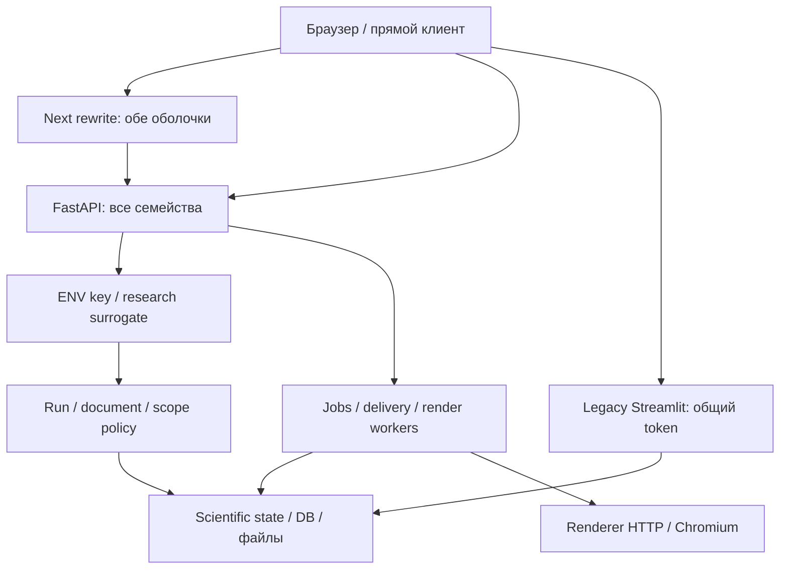

# AUTH-00 — модель угроз и точки enforcement

База: `962ccda96c15aed5d1a6661364d8c50d8a301cbe`, 30.10.2026, Москва.
Статус: source-based threat model для реализации AUTH-01…25. Это не pentest
production и не сертификат готовности AuthN. Авторитет требований —
`spec_auth_architecture.md` §3–10/12, `spec_auth.md` §3/8/9/17 и Role/Plan RP-01…15.
Исторические ограничения доступа к 21946a7/ad7dd4b в исходных спецификациях
не переносятся как факт: в AUTH-00 прочитан именно указанный текущий commit.

Связанные артефакты: [inventory.md](inventory.md), [inventory.json](inventory.json),
[policy_review.json](policy_review.json), [design.md](design.md).
В inventory у каждого входа раздельны **observed**, **target**, operation/stage,
ресурс, эффекты, admission и исходник. `target` не означает реализованный guard.

## Активы, участники и предположения

Активы: приватные datasets/series, scientific state и provenance; runs/checkpoints;
Model Cards/forecasts; snapshots/documents/revisions/renditions/jobs; tenant и
будущие Account/Membership; credentials/revoke/MFA; SupportGrants/security audit;
CPU/RAM/GPU/queue slots и будущие CU/source lots; серверные файлы и DB credentials.

| Участник | Текущая/целевая граница |
|---|---|
| Неаутентифицированный браузер/прямой HTTP-клиент | Нельзя считать CORS, URL internal или выбранную оболочку доказательством прав |
| Владелец research cookie | Сейчас surrogate subject/состояние, а не личный AuthSession |
| Держатель внешнего API-key | ENV principal; не отдельная бесплатная Account quota на каждый ключ |
| Analyst / будущий MEMBER / OWNER | Account OWNER не platform ADMIN; capabilities не объектное владение |
| ADMIN / support | ADMIN обход в текущем object resolver; support ограничен выданными scope/pairs, не impersonation |
| Форумный participant | Будущие private subject/grant/account; общий credential только entry, не общий owner |
| Delivery/render/model executor | Доверенный внутренний вызов сегодня; будущий сохранённый operation context и start/revoke guard |
| Оператор/IdP/payment provider | Отдельные операционные/внешние authorities; неподписанный callback не является разрешением |

Production origins, secrets, сетевые ACL, реальные DB/Redis и содержимое
пользовательских данных не исследовались. Наличие пути в исходнике не доказывает
его сетевую экспозицию. Поведение worker/биллинг после будущего внедрения не
выдаётся за существующее. Риски ниже ранжированы проектно; CVSS не рассчитывался.

## Потоки и границы доверия

| Граница | Недоверенный вход → доверенная операция | Обязательное место решения |
|---|---|---|
| B1 browser/proxy/API | cookies, ключи, mode/header, account IDs | API context resolver независимо от прокси |
| B2 subject/resource | run/document/job/rendition/hash IDs | Единая object policy + tenant/version до чтения и записи |
| B3 admission/execution | model/folds/trials/SQL/payload/очередь | Нормализация операции, capability/grant и atomic reservation |
| B4 execution/result | queued/running/late completion/экспорт | Recheck revoke/deadline, fence/settle и повторная проверка выдачи |
| B5 API/network/files | DB host/порт/локальный путь/template ID/объектный ключ | DB egress/file allowlist, доверенные roots/registry, parser bounds |
| B6 admin/support/audit | platform permissions, SupportGrant pairs, export | MFA/scopes/точная область, mandatory transaction/outbox |
| B7 legacy/scientific | shared token и независимый UI/вычисления | Изоляция/decommission или тот же authoritative policy, без обхода новой AuthN |
| B8 external authority | IdP assertion/payment webhook/backup | Проверенный issuer/provider + durable dedup/revoke/reconciliation |

## Реестр угроз

Каждый пункт задаёт сценарий, наблюдение и будущий отрицательный oracle. Названия
AUTH-AC относятся к **плану** `spec_auth.md`, а не к выполненным в этой задаче API tests.

### T01 — обход через direct internal/session/альтернативный endpoint

**STRIDE:** elevation/DoS. **Приоритет:** P0, подтверждённый architectural gap.
Входы: `browser.internal`, `browser.session`, stateless `/v1/models/*` и их зеркала.
`internal.py` не имеет общей AuthN dependency; публичное имя/Origin не защищают
его от прямого клиента. `public.py` требует ключ, но не полный API entitlement.
Операции candidates/backtest/diagnostics существуют в нескольких семействах.
Контроль: общий coordinator до любой науки; canonical operation не определяется
лишь URL. AUTH-01/03/10/11/12; oracle AUTH-AC15/18/19: прямой альтернативный вызов
не обходит запрет, неизвестная операция deny, outage не становится anonymous.

### T02 — research pointer принимается за личный вход и владение

**STRIDE:** spoofing/information disclosure/tampering. **P0**, подтверждённая граница миграции.
`session_store.get_or_create_session_id` принимает/выдаёт research cookie;
`identity.resolve_request_subject` может дать surrogate и наследуемого server owner.
Знание cookie остаётся bearer-доступом к текущей research state, а не новым личным входом.
Login/logout/account switch/kiosk не должны присваивать соседние результаты.
Сохранить creator continuity для доказанного владельца, но не auto-claim по run ID.
AUTH-03/04/06/09; AUTH-AC07/21/22: чужие IDs, account switch и legacy claim
не открывают чужое исследование, auth/research SID раздельны.

### T03 — неоднозначные credentials и разные adapters

**STRIDE:** spoofing/confused deputy. **P0**, наблюдаемый gap.
`identity.resolve_request_subject`: валидный key приоритетен, неверный может
провалиться в cookie. `auth.get_current_principal` имеет required Header (возможно
422 при отсутствии), а logs использует ручной `_principal_or_401` и 401.
Нужен один context: предъявленный неверный credential отвергается; разные
identity у cookie/key дают auth_ambiguous, права не объединяются.
AUTH-03/06/10; отрицательные случаи: invalid key + valid cookie, valid key A +
cookie B, missing header, revoked key, одинаковая identity с двумя credentials.

### T04 — ADMIN/capabilities/tenant не разделены

**STRIDE:** elevation/information disclosure. **P0**, наблюдаемая legacy policy.
`authorize_run_access` разрешает ADMIN до tenant-проверки; `require_admin_role`
проверяет ENV роль без личной MFA. Полные analytical caps staff не равны admin.
Нужны explicit platform permissions, MFA freshness и отдельное основание для
cross-tenant доступа; OWNER/MEMBER не ADMIN. AUTH-03/05/07/09; AUTH-AC03/04/05.

### T05 — путаница baseline/tune/custom и application aliases

**STRIDE:** elevation/DoS. **P0**, подтверждённое отсутствие versioned operation registry.
Legacy can_train_models закрывает также candidates/backtest/diagnostics;
session/internal обходят этот ключевой gate. Выбранный model_id/folds/trials
меняет стоимость: URL backtest сам по себе не означает дешёвый baseline.
Канонические restricted stages: scenario/causal/decision/monitoring; четыре
`/tasks/*` href учтены, causes уже имеет живой Model Card endpoint.
Научные EDA Granger и DOCLOG monitoring не относятся к application stage по совпадению слов.
AUTH-01/11/14; AUTH-AC18: demo bounded baseline разрешён только по серверному
allowlist, tuning/custom/GPU/прикладные aliases запрещены согласно entitlement.

### T06 — CSRF/CORS, включая изменяющий GET restore

**STRIDE:** tampering/spoofing. **P0**, наблюдаемый gap целевого browser-контракта.
В main только trace/telemetry/CORS middleware; разрешён regex *.vercel.app с
credentials. SameSite выбирается из ALLOWED_ORIGINS, это не CSRF authority.
`GET /v1/progress/runs/{run_id}/restore` создаёт новую session и cookie (action=write).
Owner check уже есть, его сохранить; смена состояния должна стать защищённой
командой, а не безопасным GET по названию. AUTH-06/09/11; AUTH-AC21/23:
CSRF/Origin/Fetch Metadata применяются к mutations, direct API также авторизован.

### T07 — бесконечное forum demo и общий owner

**STRIDE:** spoofing/elevation/DoS. **P0**, будущий сервис пока отсутствует.
`POST /v1/session/demo` сегодня загружает demo dataset, не выдаёт AuthSession
или DemoGrant. Нельзя назвать его форумным входом и считать ограничения готовыми.
Нужны shared campaign entry → private participant/account/grant, hard ends_at,
immutable issued_at/expiry и общий finite budget. Cookie/IP не доказывают человека.
AUTH-02/04/12/15/16; AUTH-AC06…12/15/17/24/25: повтор входа и новый browser
не сбрасывают общий срок/бюджет, admission consume атомарен, NAT не блокируется общим lockout.

### T08 — неограниченная стоимость, гонки admission и quota reset

**STRIDE:** DoS/tampering. **P0**, общих CU/account/grant reservations ещё нет.
Входы: DB test/load, GET EDA profiles, backtest/tune, jobs/start/step,
forecast/sensitivity/panel, render/readyz/smoke. GET может вычислять, кешировать
и freeze-ить артефакт. Размер и model/folds/trials требуют нормализации до reserve.
AUTH-01/11/12/13/14; AUTH-AC13/14/16/18: последний слот/CU получает один запрос,
retry не списывает дважды, estimate underrun не даёт отрицательный доступный баланс.

### T09 — IDOR по metadata/preview/file/job/restore и content hash

**STRIDE:** information disclosure/tampering. **P0**, существующие object controls сохраняются.
DOCLOG/Progress уже применяют owner/tenant/run/scopes и uniform 404. Нельзя
заменить их наличием личного входа или считать storage hash разрешением.
Учитываются revisions/validations/signature/diff/lifecycle, rendition content,
forecast CSV/JSON/report, polling/cancel и checkpoints/restore.
AUTH-09/11/13; AUTH-AC07/15/21: чужой и отсутствующий ID не раскрывают
существование, downgrade/revoke действует также на чтение ранее готового результата.

### T10 — DB egress, локальные файлы, templates и untrusted payload

**STRIDE:** disclosure/tampering/DoS. **P0**, доступные источники требуют отдельной политики.
DB `/test` не создаёт analysis session и может устанавливать соединение до науки;
`/load` читает данные. Host whitelist opt-in, SQLite/DuckDB принимают локальный путь.
Read-only SQL не является сетевым/файловым разрешением. Template loader имеет
fallback `rules/{template_id}.yaml`; это требует проверки allowlist/root, но здесь
не заявляется доказанное произвольное чтение. Загрузка XLSX/CSV/JSON, SVG и
render payload также имеют parser/resource boundary.
AUTH-11/14/20; отрицательные oracle: недопустимая сеть/локальный путь/selector,
лимиты размера/строк/времени. Активных SSRF/path-traversal проб production не было.

### T11 — новый key/session/account умножает лимит

**STRIDE:** spoofing/DoS. **P0**, будущий root-budget contract.
ENV registry привязывает plan к credential principal, общего Account ledger нет.
Несколько keys, второй frontend origin и ephemeral participant Account не должны
давать новые campaign/account budgets. Ротация secret не меняет stable subject.
AUTH-02/08/10/12/16; AUTH-AC09/13/14/17/27, RP-01/02/03/06/13.

### T12 — queued/running worker обходит отзыв и выдаёт поздний результат

**STRIDE:** elevation/tampering/DoS. **P0**, точка новой интеграции.
DocumentRenderWorker системно читает snapshot без subject, доверяя job admission;
DeliveryWorker повторяет доставку; session jobs исполняются также через client-driven
step. Renderer HTTP не имеет credential check, его изоляция — deployment contract.
Существующие lease/timeout/sandbox не заменяют текущие grant/reservation/fence.
AUTH-03/12/13/16; AUTH-AC15/16/19/27: revoke между enqueue/start, crash,
late completion, повтор settle и чтение после revoke закрываются независимо от queue ID.

### T13 — секреты/неполный mandatory audit

**STRIDE:** repudiation/disclosure/tampering. **P0**, существующие audit controls расширяются.
`principal_id` ENV adapter всё ещё сырой ключ; subject_id/псевдонимы безопаснее.
Подтверждён конкретный выход: заглушка `models.train_model` возвращает
`principal_id: principal.principal_id` в HTTP body. Это лишнее отражение секрета,
которое может попасть в response logs/cache; эксплуатации или внешней утечки
в этой задаче не проверялось. В AUTH-03 нужно убрать secret из DTO.
security_audit и DOCLOG уже различают standard/mandatory; новый auth сервис не
должен писать второй независимый журнал и менять права до ненадёжного audit.
AUTH-03/05/07/20; AUTH-AC20/28: роль/policy/budget и audit intent атомарны,
password/OTP/SID/key/admission/payment secrets отсутствуют в logs/URLs/bundles.

### T14 — открытая диагностика и дорогое readiness

**STRIDE:** disclosure/DoS. **P1**, наблюдаемые источники, production exposure неизвестна.
`/health` — отдельная liveness; `/health/ops` раскрывает safe projection без AuthN.
OpenAPI/docs/redoc публичны по defaults FastAPI, это не OIDC-вход.
Renderer readyz выполняет cached smoke, `/v1/smoke` полный smoke.
AUTH-01/03/14/20: public metadata allowlist явный; ops/private service,
ограничение частоты/стоимости, readiness не раскрывает credentials и не выдаёт ложный ready.

### T15 — outage/backup возвращает старые права или memory authority

**STRIDE:** elevation/tampering. **P0**, миграционный риск.
Научные stores имеют required/advisory и in-memory dev режимы; они не являются
новым authoritative AuthSession/budget store. Restore scientific state не должен
восстанавливать revoked credentials, consumed admissions или spent CU.
AUTH-02/04/12/13/16/20/25; AUTH-AC19/27/28: outage→503 без нового protected
admission; backup/replay/reconcile не оживляют доступ или финансовый баланс.

### T16 — shared rule override и кэши между Account

**STRIDE:** tampering/disclosure. **P1**, наблюдаемая область общего состояния.
`public.py`/`internal.py` держат module-global `_rules_override`, а не Account-owned
правила; research session и UI caches тоже не знают будущего active Account.
Новый login не превращает это состояние автоматически в изолированное.
AUTH-08/09/11/20: scope rule state, invalidate frontend caches на account switch,
не смешивать scientific provenance; RP-03/06/12, AUTH-AC07/21.

### T17 — расширение support grant и доступ к содержимому через logs

**STRIDE:** elevation/disclosure. **P1**, существующий control требует сохранения.
admin_logs имеет scopes/support grants. Нельзя объединить tenant/run/action lists
в декартово произведение или сделать SupportGrant правом читать dataset.
Log bundle/metadata также нуждаются в разрешении и safe projection.
AUTH-03/07/09/20; oracle: grant A/X/read не разрешает B/X, A/Y или write/export;
объектные научные права не следуют из разрешения на журнал.

### T18 — обход через UI aliases, origin или client role

**STRIDE:** spoofing/elevation. **P1**, наблюдаемая граница UI/backend.
Embedded имеет /admin/progress, standalone такого route пока не имеет.
`/analytics/ts-analysis` и `/dashboard/ts-analysis` редиректят на preprocessing;
четыре `/tasks/*` href и application stage aliases учтены в inventory.
NEXT_PUBLIC_API_MODE=internal и first-party rewrite не доказывают identity.
AUTH-01/06/07/11; AUTH-AC01/02/03/22/23/29: оба origins входят независимо,
URL/role header/JS visibility не дают право; безопасные redirects и state expiry.

### T19 — legacy Streamlit остаётся обходной scientific authority

**STRIDE:** spoofing/elevation/DoS. **P0**, отдельный существующий контур.
`app.py` вызывает shared-hash check и st.stop до scientific UI; в session_state
остаётся authenticated boolean. Имена/roles из credentials полноценно не
разделены. Все source-visible widgets перечислены как RERUN call sites,
включая DB probe/load и download_button; это не 250 независимых backend APIs.
AUTH-03/11/20: изолировать/decommission legacy deployment либо подключить
тот же AuthN/object/stage/budget coordinator. Новый FastAPI login не закрывает его сам.

### T20 — будущий wallet/payment callback подменяет admission

**STRIDE:** spoofing/tampering/repudiation. **P0 до коммерческого запуска**, сейчас endpoints отсутствуют.
Account/wallet/topups/refunds/provider webhook перечислены в architecture §12,
но не найдены как действующие маршруты. Не добавлены в inventory существующих
endpoints фиктивно. Purchase не даёт capability/ADMIN; callback браузера не credit.
AUTH-12/18/21…25: source-aware integer ledger, signature/inbox/dedup, reservation
allocations, refund/spend race, pending при неизвестном результате, reconcile и
wallet lock. Это dependency будущего запуска, не реализация платежей AUTH-00.

## Покрытие нормативных приёмочных сценариев

| Сценарии spec_auth | Угрозы/границы | Следующие задачи |
|---|---|---|
| AC01–05 | T03/T04/T13/T18, B1/B6 | 03–07/20 |
| AC06–12 | T02/T07/T11, B1/B2/B3 | 02/04/09/15/16 |
| AC13–18 | T01/T05/T08/T09/T12, B2/B3/B4 | 01/10–16 |
| AC19–21 | T02/T03/T13/T15, B1/B2/B8 | 02–04/09/12/20 |
| AC22–25 | T06/T07/T18, B1/B3 | 05–07/15/16 |
| AC26–28 | T09/T11/T13/T15/T20, B2/B3/B6/B8 | 12/17/18/20–25 |
| AC29–30 | T08/T14/T18, B1/B3/B4 | 06/07/14/16/CERT |

Оператору до activation нужны проверенные origins/proxy trust, выбор IdP/MFA,
secrets/rotation, authoritative DB, finite campaign budget и worker cancellation
bound, calibration CU, retention и payment-provider contract (если включаются покупки).
Эти открытые эксплуатационные входы не мешают завершить source inventory;
они запрещают объявлять готовым production AuthN/demo/payment launch.

## Первичные источники

Проверены 30.10.2026. Общие принципы отделены от конкретных проектных рисков:

- [OWASP Authorization](https://cheatsheetseries.owasp.org/cheatsheets/Authorization_Cheat_Sheet.html): deny-by-default, проверка каждого запроса.
- [OWASP Authorization Patterns](https://cheatsheetseries.owasp.org/cheatsheets/Authorization_Patterns_Cheat_Sheet.html): policy decision/enforcement и ограничения одного gateway.
- [OWASP Threat Modeling](https://cheatsheetseries.owasp.org/cheatsheets/Threat_Modeling_Cheat_Sheet.html): активы, потоки, границы и сценарии угроз.
- [OWASP CSRF](https://cheatsheetseries.owasp.org/cheatsheets/Cross-Site_Request_Forgery_Prevention_Cheat_Sheet.html): cookie mutations, token/origin, ограничения CORS/SameSite.
- [OWASP SSRF](https://cheatsheetseries.owasp.org/cheatsheets/Server_Side_Request_Forgery_Prevention_Cheat_Sheet.html): отдельная политика сетевых назначений.

Соответствие AAL/NIST/ASVS не заявляется. TestClient, реальные origins/SSO,
DB/Redis, платежи и браузерные attacks здесь не выполнялись. Пройденные тесты
AUTH-00 доказывают discovery/review/drift contract, а не безопасность будущих AUTH задач.
