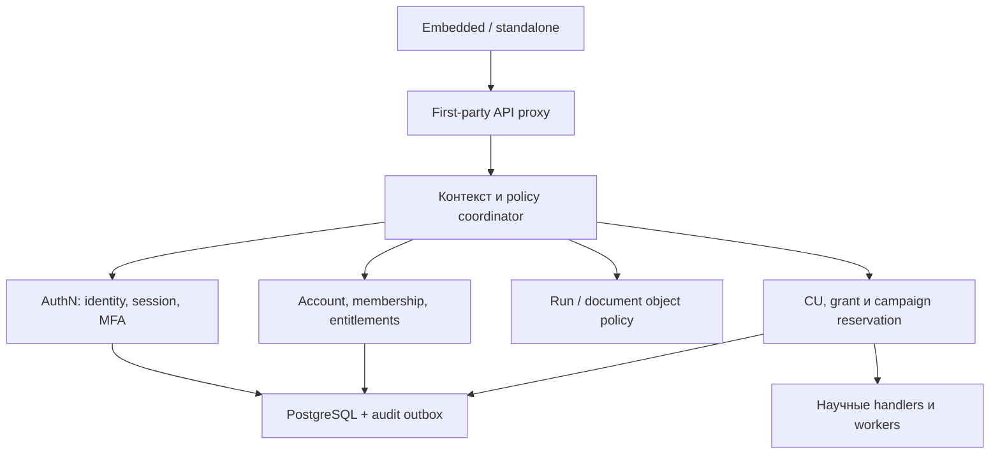

# Архитектура и общий план реализации сервиса «Авторизация»

**Дата:** 27 октября 2026 года, Москва. **База:** `ad7dd4b3bcafcccb64d9f5b2f0a97afac7fc965f`, отдельное detached рабочее дерево. GitHub-read и локальный HEAD подтверждены. **Статус:** проект реализации; этот документ не является реализацией или сертификатом готовности сервиса. Production-конфигурация не исследовалась.

Входные контракты: `spec_auth.md`, `spec_billing_accounts.md`, `docs/ROLES_AND_PLANS_SPEC.md`. Нормативные решения по их пересечениям — §3 здесь и раздел 7 обновлённого Role/Plan контракта. Числа форумных лимитов из spec_auth — предлагаемые настройки, не реализованные значения.

## 1. Наблюдаемое состояние и границы доказательств

Сначала выполнены fetch указанного commit и создание изолированного worktree, затем чтение AGENTS.md, трёх спецификаций, текущих auth/identity/роутеров, session store, очередей и DOCLOG, затем проектирование. Старые рабочие деревья не изменялись. Коммит и push не выполняются.

`spec_auth.md` в этом commit содержит редакцию 2.0-proposed с историческим блокером доступа к 21946a7 и наблюдениями на bee3f8e. Этот блокер больше не относится к настоящему исследованию: актуальный код прочитан на ad7dd4b. Однако сами новые AuthN endpoints, MFA и forum entities всё ещё отсутствуют. Исходный spec_auth не изменяется этой поставкой; его устаревшая оценка исходников заменяется настоящим §1, а не переносится как факт.

<!-- SOURCE_PATHS -->
| Исходник | Установленный факт и следствие |
|---|---|
| `apps/api/auth.py` | ENV registry; principal_id всё ещё сырой ключ, subject_id безопаснее. Header(...) может дать 422 при отсутствии ключа; будущий контракт нормализует 401 |
| `apps/api/plans.py` | Четыре плана; нет Account, INTERNAL, CU и restricted_stage_ids. Полные caps у staff/admin вычисляются через роль |
| `apps/api/identity.py` | SubjectRef, owner/tenant gate; валидный ключ приоритетен, неверный может перейти к cookie. scoped ещё не полный portal adapter; ADMIN bypass объекта до tenant-проверки |
| `apps/api/session_store.py` | cisstat_session_id и surrogate owner; cookie не личный вход. Сохранённый owner server session приоритетен; новая AuthN должна учитывать это наследование |
| `apps/api/research_runs.py` | Run owner_subject/tenant/ownership и PostgreSQL store; owner_account_id отсутствует |
| `apps/api/routers/internal.py` | Без общей AuthN dependency; название internal не защищает от внешнего вызова |
| `apps/api/routers/public.py` | require_api_key на router; это не полная проверка can_use_api/квот |
| `apps/api/routers/models.py` | can_train_models закрывает также backtest/candidates; необходима классификация операций |
| `apps/api/routers/modeling_session.py` | Cookie workflow и собственные job paths; одной правки публичного /train недостаточно |
| `apps/api/routers/forecasting_session.py` | Отдельный прогнозный путь должен получить те же guards и budgets |
| `apps/api/routers/tasks_session.py` | Уже есть XAI «Причины» поверх Model Card; утверждение «все прикладные модули отсутствуют» неверно |
| `apps/api/routers/upload_db.py` | internal probe/load без личной AuthN, public с ключом; защитить и test, и load |
| `apps/api/routers/progress.py` | Объектные guards плюс отдельные ADMIN dependencies; сохранить uniform 404 |
| `apps/api/document_lifecycle.py` | Существующий lifecycle документов; интегрировать context, не создавать второй объектный policy engine |
| `apps/api/admin_logs.py` | SupportGrant/scopes, у ADMIN unrestricted; support не означает доступ к данным исследования |
| `apps/api/routers/logs.py` | Собственный key-only adapter помимо Depends: мигрировать отдельно |
| `apps/api/security_audit.py` | Durable audit и mandatory/standard семантика; расширять действующий каталог |
| `apps/api/document_render_worker.py` | Отдельный worker; session cookie нельзя считать его credential |
| `apps/api/modeling_tuning.py` | TuningPlanExecution и выбранные trials — вход для CU, не готовый финансовый ledger |
| `app/eda/structural_breaks.py` | MAX_PELT_GRID_POINTS и jump уже ограничивают сетку; использовать фактический бюджет |
| `packages/ui/lib/plans.ts` | Ручное зеркало camelCase; нет account-aware context |
| `packages/ui/lib/navigator-stops.ts` | Четыре soon:true, хотя XAI-срез уже существует; доступность продукта и тариф различать |
| `apps/embedded/app/admin/progress/page.tsx` | Admin route есть только в embedded |
| `apps/standalone/next.config.mjs` | First-party rewrite уже существует; это ещё не session/CSRF BFF |
| `app/core/auth.py` | Legacy Streamlit token/hash; отдельный вход, не новый единый authority |
<!-- SOURCE_PATHS -->

Минимальные read-only проверки спорных предположений:

| Гипотеза | Проверка | Подтверждение / опровержение |
|---|---|---|
| Account/CU уже реализованы | Поиск AccountMembership/reserve_compute_units/restricted_stage_ids в apps/packages | Runtime definitions найдены / только спецификации; на базе runtime не найден |
| Защита /models покрывает browser | Сравнить dependencies internal/session/modeling/forecasting и public | Одинаковые gates / обходные пути; на базе общего gate нет |
| scoped означает рабочий SSO | Прочитать resolve_request_subject и описание MODE_SCOPED | Верификация issuer/signature/session / surrogate; на базе surrogate |
| Админка есть в standalone | Инвентаризация apps/standalone/app/admin | Реальные pages / отсутствие; на базе отсутствует |

Это статический аудит архитектурных точек, не penetration test и не browser-E2E.

## 2. Граница сервиса и размещение

Рекомендуется **единый логический сервис доступа**, первоначально внутри существующего FastAPI. Разделить модули и владельцев данных сейчас; отдельный сетевой deployment не делать prerequisite личного входа. Это соответствует текущим «Прогресс»/DOCLOG сервисам в apps/api и позволяет атомарно решать membership, quota и audit без распределённой транзакции.

- `apps/api/auth.py` — совместимый фасад Depends, без второго реестра прав.
- Новый `apps/api/authentication/` — credentials, identities, sessions, MFA, OIDC, API keys, forum entry.
- Новый `apps/api/accounts/` — Account/Membership/invitations/seats и entitlement resolution.
- Новый `apps/api/billing/` — CU ledger/reservations, pricing/provider adapter; AuthN не вызывает платёжный provider на каждом запросе.
- `identity.py` и общий policy coordinator — единственный subject/object access путь; научные роутеры и workers — точки enforcement.
- PostgreSQL — authoritative durable store. Redis — throttling/cache/leases, не единственный источник отзыва или финансового баланса. In-memory только тест/dev, не production fallback.

Если позже требуется физически отдельный процесс, добавить ASGI entrypoint с теми же доменными модулями, private service-auth transport и versioned introspection/authorization/reservation API. Только владелец схемы пишет свои таблицы; научный API не выполняет SQL join в чужую БД. Object decision остаётся у владельца ресурса. Для немедленного revoke требуется online introspection на защищённом запросе; stateless JWT/offline положительный cache не равноценны. Таймаут authority → 503, без anonymous fallback. Выделение процесса требует отдельной приёмки задержек, отказов и согласованности; оно не нужно для первого функционального релиза.

## 3. Решения по трём спецификациям

| Решение Role/Plan | Общая архитектура и корректировка прежних предложений |
|---|---|
| RP-01 | Persisted identities и credentials раздельно; stable subject переживает смену ключа. Не таблица «один ключ = один клиент с plan» |
| RP-02 | Уровни account/grant/campaign/sponsor; общий reservation, rate limits отдельно от денежных CU |
| RP-03 | Account.plan + entitlement_version; cookie не хранит authoritative plan; изменение проверяется до admission и worker start |
| RP-04 | OpenAPI/Pydantic DTO + generation TS и parity CI; frontend получает эффективные caps, не вычисляет полный доступ из role |
| RP-05 | ADMIN permissions + MFA; internal service Account с INTERNAL entitlement без коммерческой цены, но с техническими лимитами; INTERNAL не выбирать в pricing UI |
| RP-06 | Account и tenant связаны серверной записью; в v1 отдельный tenant на Account. MONO→MULTI сохраняет оба ID; не принимать tenant из тела запроса |
| RP-07 | Atomic membership/invite; seats не свободно редактируемый счётчик. Invitation не создаёт второй User для уже известной identity |
| RP-08 | Versioned capability split: can_run_baseline_models, can_tune_models, can_train_custom_models; legacy can_train_models временный adapter, не переименование значения |
| RP-09 | restricted_stage_ids сохраняется как продуктовый контракт, известные операции имеют явную policy. Неизвестная операция deny даже при пустом deny-list |
| RP-10 | Shared campaign credential не User/OWNER; private participant + DemoGrant + временный MONO; sponsor pool отдельно от participant seats |
| RP-11 | Opaque AuthSession, first-party cookies/CSRF и безопасная проксификация; исследовательская cookie остаётся только указателем ресурса |
| RP-12 | Один SubjectRef/authorize_run_access, расширенный account-aware context; legacy claim только с доказательством владения |
| RP-13 | Compute pricing отдельно от subscription price; calibrated fixed-point CU ledger, seats/proration без бесплатного reset |
| RP-14 | Mandatory audit intent/outbox в транзакции изменения; отказ authority закрывает доступ; поэтапный enforce rollout |
| RP-15 | CU-WALLET-1: самостоятельная покупка, source lots, wallet permissions и refund/dispute authority; см. §12 |

Решение конфликта demo: все шесть этапов доступны в ограниченном режиме. Demo/starter получают baseline из серверного allowlist (например naive/seasonal-naive/drift с ограниченными folds/horizon); tuning, произвольный fit и GPU для demo запрещены. Professional/enterprise получают advanced возможности по entitlement. Точные каталоги/потолки фиксируются в AUTH-01 и калибруются до включения. Базовый прогноз честно вычисляется на загруженных данных; подготовленный пример маркируется примером. Это изменение нормативного контракта, а не утверждение, что текущий False уже разрешает бэктест.

Четыре прикладных module ids закрыты для demo; starter открыт согласно billing §5.3. XAI paths/aliases входят в gating сейчас. Научная EDA Granger и служебная DOCLOG monitoring не становятся платными автоматически из-за совпадения названия. `soon` сообщает готовность функции, entitlement — право пользователя.

## 4. Данные и инварианты

| Сущность | Обязательные свойства |
|---|---|
| Identity / ExternalIdentity | immutable subject_id; unique issuer+sub; verified email не основание автоматического merge |
| Credential / APIKey | random id, hash, status, owner subject/service, account binding, scopes ceiling, expiry/revoke; секрет только при выдаче |
| AuthSession / Challenge | hash opaque token, identity, absolute/idle expiry, auth_time/MFA, family/version/revoke; challenge одноразовый и ограничен попытками |
| Account / Membership | account_type, tenant, plan/version/status, OWNER/MEMBER, unique account+subject, exactly one MONO member; последний OWNER защищён |
| Invitation | token hash, inviter, target/email, scope, expiry, consumed/revoked, idempotency; membership и seats меняются атомарно |
| DemoCampaign / EntryCredential | fixed starts/ends, policy version, finite sponsor budget/max grants/concurrency, secret hash; activation без конечных лимитов запрещена |
| DemoParticipant / DemoGrant | private subject/account, immutable issued_at/expires_at, usage, status; expired grant нельзя обновить повторным входом |
| Reservation / UsageLedger | unique operation_id, payload digest, amounts in integer sub-CU, pending/running/settled/released, lease/fencing; append-only postings |
| AuditOutbox / ProviderInbox | event_id, transaction correlation, replay/dedup, publication status; provider signature и event ordering |
| Resource ownership | owner_account_id добавляется к run/session; owner_subject сохраняется как provenance; tenant/версии проверяются на read/write/export/restore |

Account membership разрешает только назначенные операции: MEMBER работает с ресурсами аккаунта согласно object policy; OWNER управляет составом/оплатой, не получает platform-admin. При MONO→MULTI UI явно сообщает о командном доступе к account-owned исследованиям. Личные/legacy unresolved ресурсы не становятся общими молча. Исторические события и подписи не переписываются ради миграции.

Логовые SupportGrant и DemoGrant — разные сущности. Доступ поддержки ограничивается разрешёнными парами tenant/run/action: нельзя объединить списки tenants и runs в декартово произведение, дающее лишние права. Унаследованный ADMIN bypass при миграции заменяется явным platform permission, MFA и аудитом; расширение tenant-boundary допускается только явно разрешённой admin-операцией.

## 5. Контекст и последовательность проверки

RequestContext: subject_id, credential/session id, auth_method/MFA freshness, active account_id/tenant_id, membership, platform permissions, scopes, entitlement_version, demo grant, request_id. IDs с клиента выбирают объект, но не доказывают права. Активный account принимается только после membership-проверки; API key связан с разрешённым Account, переключить произвольным заголовком нельзя.

1. Определить семейство endpoint и допустимый credential. Неверный предъявленный credential → отказ; cookie+key с разными identities → 400 auth_ambiguous, права не объединять.
2. Проверить действующие session/identity/account; получить один context для auth.py и identity.py. В production protected routes не используют surrogate как замену входа.
3. Проверить permission/MFA, tenant и object policy, затем stage/capability/grant.
4. До выполнения атомарно зарезервировать нужные API/analysis/CU/concurrency лимиты и записать job/outbox.
5. Worker получает service credential и сохранённый operation context, перепроверяет права/expiry/fencing до старта, ограничивает runtime. Чтение результата повторно проверяет доступ.

401 — отсутствующий/истёкший вход; 403 — permission/grant запрет; 404 — объект чужой или отсутствует; 402 — plan/CU barrier; 409 — stale version/idempotency conflict; 429 — throttle/concurrency; 503 — недоступность authority. Тело: code, безопасное message, request_id; billing details доступны только уполномоченному аккаунту.

## 6. Сценарии и интерфейсы

**Администратор:** в каждой оболочке `/login?return_to=/admin` → личный password+MFA либо доверенный OIDC Code+PKCE → `/admin`. Общие UI компоненты: progress, users/sessions, campaigns, logs/support, policies. `return_to` только локальный allowlist. WebAuthn предпочтителен, TOTP fallback по политике; bootstrap — одноразовый CLI, не публичный first-admin endpoint. Recovery codes хешированы; recovery отзывает сессии. Sensitive changes требуют свежего step-up. Числа 8h/15m/5m из spec_auth — стартовые предложения политики.

**Обычный пользователь:** личный вход → MONO Account OWNER; self-service переход MULTI, приглашения, состояние subscription/usage. Идентичность может входить в несколько Account; каждый запрос имеет один активный контекст. Смена Account очищает клиентские caches и выбранную research session.

**Форум:** общий логин/пароль → private grant. `expires_at=min(campaign.ends_at, issued_at+duration)`; now>=expires_at — запрет. Повторный login/refresh не сбрасывает бюджет или время. Для строгой выдачи добавить одноразовый admission code, отдельно от resume credential. Cookie/IP не доказывают уникальность человека; новый браузер может получить новый grant в мягком режиме, но не обойти общий hard end/budget. NAT rate limiting не блокирует общую пару глобально после нескольких неверных паролей.

**Browser transport:** `__Host-` auth cookie Secure/HttpOnly/Path=/ без Domain, отдельная от cisstat_session_id; server sessions. CSRF token + Origin/Fetch Metadata для изменяющих cookie-auth операций, включая login/logout; SameSite дополнительный барьер. Разные origins имеют свои host-only cookies; общий login обеспечивается IdP, а не переносом bearer через URL. Embedded iframe требует top-level login/согласованного portal handoff; не полагаться на third-party cookies. Прокси удаляет неподписанные identity headers; API проверяет сессию и при прямом вызове.

**Personal trial/magic link:** persisted одноразовый challenge, лимит попыток/TTL; GET по ссылке не погашает токен из-за mail scanners. OTP защищается keyed hash, пароль Argon2id; высокоэнтропийные API/session tokens — hash. Email outage не открывает вход. Личный trial и форум не используют один общий User.

Предлагаемые группы API (новые, пока отсутствуют):

| Группа | Операции и граница |
|---|---|
| /v1/auth | login/logout/me/sessions/revoke, MFA enroll/verify/step-up, OIDC start/callback, recovery; публичны только явные entry/challenge операции |
| /v1/accounts | list/select, members/invitations, MONO→MULTI, ownership transfer; membership/OWNER gates |
| /v1/api-keys | issue/list/revoke; can_use_api и scopes ceiling, secret один раз |
| /v1/demo | enter/me/resume; общая пара только entry, private session на последующие действия |
| /v1/admin/demo-campaigns | create/update version, schedule/activate/pause/revoke, usage; ADMIN+permission+MFA |
| /v1/billing | entitlement/usage/quote/subscription; OWNER для управления; webhook signature/inbox вместо browser auth |

Документационные/научные API остаются на существующих путях. Весь route inventory получает public/protected classification; /health и статическая информация явно разрешаются, неизвестный новый protected endpoint по умолчанию закрыт.

## 7. Метeринг, seats и транзакции

Не резервировать CU внутри «слепой» capability dependency до валидации фактической операции. Coordinator получает нормализованные rows/columns/model/folds/trials и operation_id, проверяет capability и вызывает billing reservation. Повтор с тем же idempotency key и payload возвращает прежний результат; другой payload — 409.

Единица analysis в v1 — первый успешный admission нового ResearchRun; validation/preprocessing/EDA в нём не создают новые analyses. Новый явный run/fork считается новым; restore прежнего run — нет. API monthly quota — принятые запросы программного API с согласованным registry исключений polling/health; browser вычисления оплачиваются CU и analysis budget. Retry с прежним operation_id не удваивает CU.

Одна транзакция блокирует строки budget в детерминированном порядке sponsor→campaign→account→grant, сверяет spent+reserved+estimate, создаёт reservation и job/outbox. В ledger не использовать float. Settle списывает фактически разрешённую стоимость, release возвращает неиспользованный резерв. Если actual требует больше estimate — сначала дополнительный резерв или остановка по hard budget, не отрицательный баланс задним числом. Fencing запрещает двойной settle и публикацию позднего результата. Истёкший lease не означает безопасный refund: reconciler сначала подтверждает остановку worker.

CU coefficient version сохраняется на операции. PELT jump/grid и tuning selected trials/folds — входные измерения, не финансовая истина. Значения base/exponent и производственные лимиты определяются benchmark, до этого коммерческий CU launch закрыт.

Seats: линейный price×seats, pool per-seat pooled. Invitations в paid MULTI: quote → подтверждение OWNER → provider entitlement/допустимый credit → activation membership. Pending invite не даёт доступ и бесплатный CU. Membership update и provider sync через outbox/saga; provider не внутри SQL lock. Retry/webhooks dedup. Уменьшение seats не обнуляет spent/reserved; увеличение даёт только положенную prorated квоту. Повтор add/remove не выпускает новую полную квоту. Последнего OWNER сначала передать; MULTI→MONO только при одном участнике и согласованной политике незавершённых обязательств.

## 8. Миграция и эксплуатация

Следующая свободная миграция на базе — после 0015; проверить номер при реализации, не перезаписывать существующие SQL. Additive schema → dual adapter → shadow decisions → измеренное сравнение → enforce по семействам → прекращение ENV/legacy browser-admin keys. Секретные legacy principal_id не копировать в subject/audit.

Привязка старых runs: authenticated user + доказанная серверная непрерывность своей сессии + tenant + одноразовый CAS transfer, либо административная миграция с основанием. Знание cookie/run_id само по себе не массовый claim. Restore не меняет owner. После login/logout/account switch research pointer ротируется/отвязывается: другой пользователь на kiosk не наследует документы из сохранённого owner cookie. Scientific content и исторические audit bytes не переписываются.

Auth stores production работают fail-closed. Readiness отражает authoritative DB/keys/schema, liveness не раскрывает секреты. Mandatory изменения ролей, membership, кампании, квот/ключей фиксируются с audit intent/outbox атомарно; standard deny logging остаётся best-effort и не превращает отказ в разрешение. Использовать существующий security_audit, не второй независимый журнал.

Cleanup demo удаляет временные научные данные/рендеры по retention, соблюдает holds и сохраняет минимальный ledger/audit; history capability не отключает provenance. Backup restore требует reconciliation отзыва/consumed codes/settled operations; при сомнении кампании и сессии закрываются до reconciliation. Rollback отключает новые входы/вычисления, но не возвращает production к открытому /internal или revoked legacy keys.

## 9. План работ и критерии готовности

Каждая строка — самостоятельная TDD-итерация: дизайн/точки изменения/риски → RED → код → GREEN → затронутый регресс/сборка → worklog/ZIP. Здесь эти software-тесты ещё не выполнены. AUTH-xx — namespace этого общего плана; старые AUTH-0…5 из spec_auth — укрупнённые фазы, не тождественные номера.

| Задача | Зависимости | Результат | Основные точки изменения | Критерий приёмки |
|---|---|---|---|---|
| AUTH-00 | — | Полный route/operation inventory и threat model | main, routers, workers, legacy app | Каждый вход classified; прямые internal, DB probe, task aliases и file paths учтены |
| AUTH-01 | AUTH-00 | Versioned capabilities/stage/operation registry | plans.py, OpenAPI, plans.ts | Demo baseline разрешён, tuning/custom запрещены; неизвестная операция deny; generated TS parity |
| AUTH-02 | AUTH-00 | Durable identity/account schema и repositories | authentication, accounts, migrations | Unique subject/issuer/member constraints; rollback и рестарт проверены на PostgreSQL |
| AUTH-03 | AUTH-02 | Unified context и compatibility adapters | auth.py, identity.py | Неверный ключ не падает в cookie; ambiguous identities отклонены; principal_id не секрет |
| AUTH-04 | AUTH-03 | Opaque sessions, password и revoke | authentication/session/credentials | Fixation/expiry/logout/revoke и DB outage проверены; токены не в логах |
| AUTH-05 | AUTH-04 | MFA, bootstrap и recovery | authentication/mfa, CLI | Challenge не сессия; step-up обязателен; одноразовый bootstrap/recovery replay закрыт |
| AUTH-06 | AUTH-04 | First-party proxy/CSRF и общий login UI | обе apps, packages/ui | Оба origins работают; CSRF/Origin/open redirect/подмена headers не дают вход |
| AUTH-07 | AUTH-05, AUTH-06 | Общая админка обеих оболочек | admin pages, AdminProgressDashboard, admin.ts, logs adapter | Named ADMIN+MFA управляет реальными API standalone/embedded; analyst/OWNER получают отказ |
| AUTH-08 | AUTH-02, AUTH-03 | Account entitlements и membership lifecycle | accounts, plans.py | План из Account; MONO invariants, active account и immediate downgrade проверены |
| AUTH-09 | AUTH-08 | Object ownership bridge и legacy migration | identity, session_store, runs, DOCLOG lifecycle | owner_account_id, foreign tenant 404; restore и account switch не передают чужие объекты |
| AUTH-10 | AUTH-08 | API keys durable lifecycle | authentication/api_keys, public/upload_db | Hash-only, rotation не меняет subject; scope ceiling и can_use_api проверяются сервером |
| AUTH-11 | AUTH-01, AUTH-09, AUTH-10 | Enforce guard на всех научных путях | internal/session/modeling/forecasting/tasks/DB | Прямой вызов каждого альтернативного маршрута не обходит entitlement и object gate |
| AUTH-12 | AUTH-08 | Atomic ledger/reservation coordinator | billing, job stores/outbox | Гонка за последний CU/API/analysis допускает один запрос; idempotency не удваивает расход |
| AUTH-13 | AUTH-11, AUTH-12 | Worker guard/settle/fencing/reconciliation | modeling, delivery, render workers | Revoke между queue/start, worker crash, поздний complete и retry не дают лишний charge/result |
| AUTH-14 | AUTH-01, AUTH-12 | Benchmark CU и технических потолков | PELT/tuning adapters, benchmark scripts | Измеренные coefficients/version и hard runtime bounds; estimate underrun ограничен |
| AUTH-15 | AUTH-07, AUTH-08, AUTH-12 | Campaign admin и isolated demo enter | authentication/demo, admin UI | Общая пара выдаёт частные grants/accounts, finite policy обязательна при activation |
| AUTH-16 | AUTH-13, AUTH-15 | Demo expiry, admission, quotas и cleanup | demo, lifecycle, workers | Повторный вход не продляет expiry; concurrent code consume один раз; cleanup сохраняет audit |
| AUTH-17 | AUTH-08, AUTH-12 | Invitations/seats/OWNER transfer | accounts, UI | Last OWNER защищён; replay/последнее место/seat churn не дают лишнюю membership/квоту |
| AUTH-18 | AUTH-12, AUTH-17 | Provider adapter, quote/webhook saga | billing/provider, inbox/outbox | Signature/order/dedup и provider outage не активируют неоплаченные места; proration проверен |
| AUTH-19 | AUTH-04, AUTH-06, AUTH-08 | OIDC/personal trial/email self-service | authentication/providers/challenges | issuer+sub/PKCE/state/nonce; mail scanner не consume; email не auto-merge |
| AUTH-20 | AUTH-09, AUTH-13, AUTH-16, AUTH-18 | Audit/operations и миграционный rollout | security_audit, health/ops, migrations, runbooks | Mandatory fault не оставляет неучтённое изменение; backup/revoke reconciliation и safe rollback проверены |
| AUTH-21 | AUTH-12, AUTH-18 | Source-aware Wallet/CreditLot и миграция | billing/wallet, ledger, migrations | Included отделён от purchased; integer rounding, expiry/reserve и cycle rollover не теряют средства |
| AUTH-22 | AUTH-21, AUTH-18 | Quote/top-up checkout и credit | billing/topups, provider/inbox, UI | Только confirmed server payment начисляет CU; duplicate events/callback spoof/currency tamper закрыты |
| AUTH-23 | AUTH-22, AUTH-13 | Refund/dispute/chargeback workflow | billing/refunds, workers, audit outbox | Spend/refund race безопасна; unknown result держит hold; spent chargeback не даёт отрицательный available |
| AUTH-24 | AUTH-22, AUTH-23, AUTH-08 | Wallet permissions/UI и lifecycle | accounts, billing DTO, обе оболочки | OWNER покупает, MEMBER только разрешённо расходует; expiry/seat/owner change сохраняют purchased |
| AUTH-25 | AUTH-23, AUTH-24, AUTH-20 | Payment reconciliation/restore и launch runbook | billing/reconciliation, ops, integration tests | Crash/backup/provider replay не создают дубликаты; terms/catalog подтверждены до real checkout |
| AUTH-CERT | AUTH-07, AUTH-10, AUTH-11, AUTH-14, AUTH-16, AUTH-17, AUTH-18, AUTH-19, AUTH-20, AUTH-25 | Сквозная приёмка сервиса | отдельные API/browser/concurrency/failure suites | AUTH-AC01…30 spec_auth + billing account/seats/stage тесты; реальный PG/Redis и обе оболочки; ограничения акта явные |

Релизы: R1 — identity/session/MFA/admin в обеих оболочках (00–09, с guards до публичного включения); R2 — enforced scientific paths + budgets/workers + forum (10–16); R3 — team/commercial/self-service (17–20). Нельзя открыть форум до атомарных лимитов и worker guards. OIDC не блокирует локальный MFA-вход; платный MULTI не запускается до согласованного provider/credit workflow.

## 10. Сквозная приёмка и риски

Дополнить AUTH-AC01…30 из spec_auth следующими явными оракулами:

- Один User в двух Account не переносит данные/caches/ключи; MONO→MULTI сохраняет run IDs и явно меняет совместный доступ.
- OWNER не ADMIN; internal entitlement не отменяет tenant/object policy. SupportGrant на tenant A/run X не открывает tenant B/run X или A/run Y.
- Demo проходит upload→validation→preprocessing→EDA→bounded modeling→forecast; каждый прямой tuning/custom/прикладной endpoint закрыт.
- Одновременные invite/seat/CU admission, crash после reserve/до queue и после execute/до settle не создают двойной расход или бесплатный результат.
- Downgrade, campaign pause и identity revoke действуют на polling, restore, render/download и job start; завершение worker не снимает запрет чтения.
- ENV removal/key rotation/salt migration/backup restore сохраняют доказанное владение и не воскрешают отзыв.

Основные риски: обходные cookie/internal paths (закрываются inventory+negative tests); потеря legacy ownership (CAS migration и rollback rehearsal); неограниченный форум (hard end/budget/worker fencing); бесплатный seat churn (prorated ledger); расхождение UI/API (generation + server me); обязательный audit после записи (transaction/outbox); недоступный authority (503, наблюдаемость); чрезмерный ADMIN bypass (explicit permission/MFA/область).

Необходимые эксплуатационные входы до activation: IdP metadata при использовании SSO, секреты/ключи и ротация, SMTP для personal email, capacity форума/NAT, finite campaign limits, измеренные CU, retention/holds и выбранный provider. Это настройки отдельных релизов, не причина откладывать проектирование общего контракта.

## 11. Верификация этой поставки и источники

Изменены только документы и проверяющий скрипт. Doc-contract RED→GREEN проверяет полноту решений, DAG задач, существование ссылок на исходники, согласованность Markdown; он не проверяет безопасность будущего кода. Software build не запускался: runtime/TS/dependencies не менялись. Проверки и границы записаны в scripts/auth_architecture и worklog11.

Общие принципы deny-by-default и проверки каждого запроса сверены с [OWASP Authorization Cheat Sheet](https://cheatsheetseries.owasp.org/cheatsheets/Authorization_Cheat_Sheet.html); разделение мест решения и enforcement — с [OWASP Authorization Patterns](https://cheatsheetseries.owasp.org/cheatsheets/Authorization_Patterns_Cheat_Sheet.html). Auth/session подход сопоставлен с [NIST SP 800-63-4](https://csrc.nist.gov/pubs/sp/800/63/4/final). Конкретные модули, бюджеты, этапы и лимиты — проектные решения этой платформы; соответствие NIST/AAL не заявляется.

## 12. Покупаемый баланс CU — CU-WALLET-1

**Дополнение от 27 октября 2026 года; проект, не реализовано.** Нормативные правила валюты, лотов, платежей и возвратов — [spec_billing_accounts.md §13](spec_billing_accounts.md#13-валюта-платформы-и-самостоятельно-покупаемый-баланс--cu-wallet-1). Этот раздел расширяет §4, §6–10 и RP-13; решения первой редакции о subscription/included сохраняются, но не описывают весь wallet.

### 12.1 Смысл и границы

CU — внутренняя неденежная единица права Account на вычислительные услуги; не transferable money и не способ оплаты мест. Отдельно существуют subscription price, top-up money price и calibrated operation cost. Account Wallet объединяет included, purchased и promotional lots, не смешивая их происхождение и условия. Авторитет — integer micro-CU ledger в billing; в AuthSession нет самостоятельного баланса.

Покупка CU не выдаёт ADMIN/membership/capability и не снимает grant/tenant/resource guards. В v1 OWNER активного платного Account может покупать; MEMBER расходует только разрешённые операции из общего пула. Demo participant и INTERNAL не получают покупаемый wallet через общий credential. Средства sponsor не мигрируют в личный Account.

`can_purchase_cu` и `can_spend_cu` — effective permissions, вычисляемые сервером из membership/account status/product configuration. Это не два безусловных boolean в cookie и не признак платёжеспособности: can_spend_cu ещё требует успешного admission по балансу. При недостатке CU — 402 `cu_insufficient`, finance hold — 403 `wallet_locked`, недоступность authority — 503. Для MEMBER сообщение ведёт к OWNER, не к checkout. При отсутствии capability предлагается смена тарифа, а не бесполезное пополнение.

### 12.2 Владельцы модулей и данных

- authentication проверяет identity/session/MFA; accounts — OWNER/membership и entitlement; billing — quote/order/payment/refund/wallet/ledger. Scientific coordinator запрашивает reservation, но не начисляет CU и не доверяет browser payment callback.
- `billing/wallet`, `billing/topups`, `billing/refunds`, `billing/reconciliation` — новые логические модули, использующие существующие provider adapter/inbox/outbox. ReservationAllocation хранит ссылки на source lots.
- Credit, order state и mandatory audit outbox коммитятся одной PostgreSQL-транзакцией. Unique credit-per-order плюс provider_event_id предотвращают два начисления. Сетевой provider call выполняется через workflow/outbox вне SQL lock.
- Summary в me/Account UI — ограниченная проекция; цены/денежные платёжные документы доступны OWNER или уполномоченной support policy, не всем MEMBER.

### 12.3 API и UI

Добавляются `/v1/billing/topup-quotes`, `/v1/billing/topups`, `/v1/billing/topups/{id}`, `/v1/billing/topups/{id}/refunds`, `/v1/billing/refunds/{id}`, `/v1/billing/wallet`, `/v1/billing/ledger`. Отдельный provider webhook проверяет подпись и environment/merchant/payment amount/currency/order, не browser session. Для cookie-auth mutations обязательны CSRF и account authorization; idempotency ключ ограничен account+action+payload.

«Аккаунт → Баланс CU»: available по источникам, reserved, дата сгорания included/promotional, purchased без срока сгорания в v1, история операций и pending/locked. OWNER видит «Пополнить», выбирает пакет, подтверждает quote с суммой/валютой/условиями и открывает hosted checkout. Возврат на страницу показывает pending до confirmed credit. Автопополнение не включается. Повторный вход/смена оболочки не создают новый wallet.

Страница заказа показывает paid/credited/failed/refund_pending/refunded/disputed из серверного состояния; старый polling response не откатывает более новое состояние. Self-service возврат — только целый неиспользованный purchased lot по разрешённым условиям заказа; исключения отдельным audited workflow. Удаление Account сначала решает незавершённые платежи/holds, а не удаляет финансовую историю.

### 12.4 Reservation, refund и lifecycle

Расход FEFO: ближайший expiry, при равенстве included→promotional→purchased; бессрочные purchased после срочных lots. Reservation фиксирует allocations, coefficient/rounding version и max charge. Settle/release работают по исходным lots; expired included при release не оживает. Новый цикл начисляет только новый included, не обнуляет purchased и не переносит spent в новый свободный бюджет. Seat churn не создаёт free credit.

Refund транзакционно переводит available lot в refund_pending до вызова provider. Spend/refund конкурируют на одной authority и не могут использовать одни CU. При таймауте результат остаётся неизвестным/pending до reconcile; достоверный отказ освобождает hold, успех окончательно погашает lot. Chargeback на использованный пакет блокирует новые admissions (`wallet_locked`) и создаёт отдельную exposure/debt запись; available не становится отрицательным. Новая покупка автоматически не погашает спор и не снимает lock.

Отмена подписки/переход тарифа сохраняет purchased, но просроченный/suspended Account в v1 не запускает платные вычисления без допустимого entitlement. MONO/MULTI и смена OWNER сохраняют wallet ID. Рестарт, backup и reconcile не воскрешают consumed credits, refunded lots или старые reservations. При uncertain financial state — hold, а не подстановка Memory wallet.

### 12.5 Задачи и дополнительные критерии

Задачи AUTH-21…25 включены в общий DAG перед AUTH-CERT. Новый объём сертификации: payment callback spoof, повтор/out-of-order webhook, два event IDs одного payment, не тот merchant/environment/currency/amount, refund-versus-spend race, неизвестный исход refund, chargeback после settle, purchased на смене цикла, истечение included во время job, seat churn, Account switch, финансовая приватность MEMBER и integer overflow/rounding. Numerical examples E1…E6 в billing §13.10 — независимые приёмочные данные, а не действующий прайс.

Релиз R4 — самостоятельная покупка и refunds после R3: provider/условия/каталог и reconciliation готовы до включения реального checkout. Авторизация и базовый forum не зависят от top-ups. Изменение касается спецификаций; реальных платежей, wallet credits или runtime endpoints эта поставка не создаёт.
