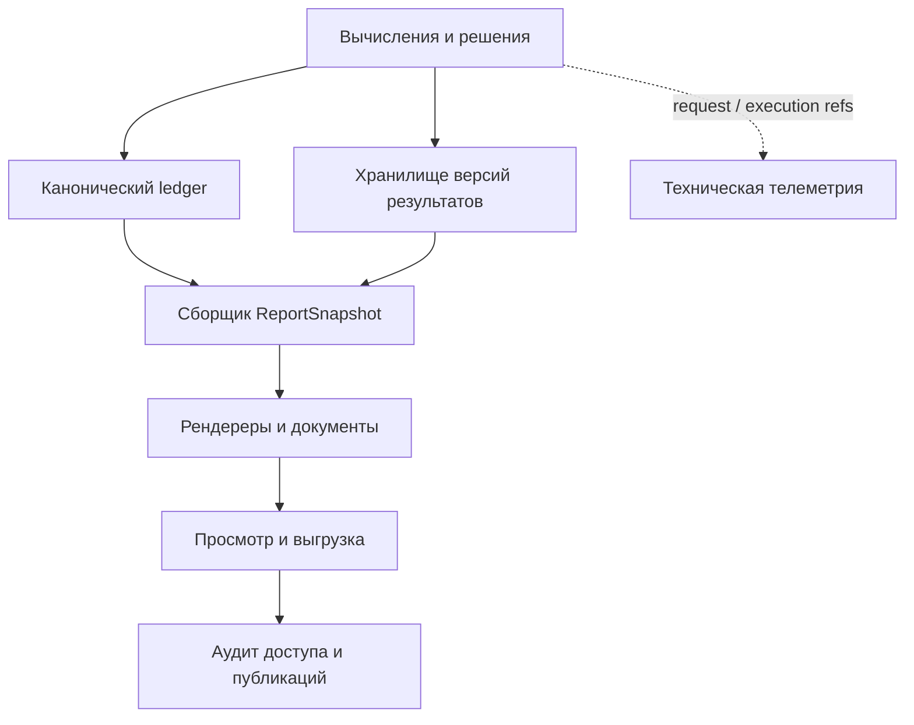

# Спецификация документирования и логирования CISStat TS Analysis

Версия: **0.1, архитектурное предложение**. Дата: **21 октября 2026 года, Москва**.
Исследованная база: `bee3f8e300e6d2f5de6f8c9d9e4d6bc6e4091065`.
Задача: DOCLOG-DESIGN-1. Изменение продукта этой поставкой не выполняется.

Предлагается развивать существующие ResearchRun, трассу и паспорта в систему доказуемых документов исследования. Документы должны собираться из закреплённых результатов и решений, технические логи — помогать эксплуатации, аудит доступа — подтверждать действия с защищёнными ресурсами. У этих данных общие идентификаторы, но разные назначение, права и сроки хранения. Сервис реализуется сначала как модули нынешнего API и UI, без обязательного выделения новых сетевых микросервисов.

## 1. Краткая хронология наблюдаемого поведения

Это последовательность **существующих путей кода**, а не запись сеанса живого браузера. Изменения состояния ниже не выполнялись над пользовательскими данными.

| Шаг | Что происходит по реализации | Носитель доказательства |
|---|---|---|
| 1 | Загрузка создаёт DataFrame, контекст исследования и исходный паспорт. Источником может быть файл или БД; у БД нет fingerprint исходного файла | `apps/api/upload_common.py`, `session_store.py`; F01/F14 |
| 2 | Валидация проверяет качество, отдельные применения коррекций изменяют данные. Предобработка создаёт цепочку преобразований. История паспортов отделена от текущего кадра | `apps/api/routers/session.py`, `session_store.py`; F01/F02 |
| 3 | Для однорядного пути существуют точки `start`, `validation`, `exit`, `modeling_entry`; панель использует отдельный `panel_entry` | F01/F12. Нельзя называть панельный паспорт четвёртой однорядной редакцией |
| 4 | Моделирование сохраняет бэктесты, OOF, параметры, диагностику и Model Card; сущностная панель имеет отдельные backtest/forecast пути | `apps/api/routers/modeling_session.py`; F12 |
| 5 | Прогноз хранит параметры и результаты. UI предлагает CSV/JSON и PNG; PDF в этом меню явно недоступен. GET CSV/JSON-экспорта записывает `forecast_exported` и сохраняет сессию | F05/F06 |
| 6 | «Прогресс» объединяет события. API отчёта формирует MD/HTML из долговременного слоя, со ссылками на события и применимостью current/stale/unknown. Тексты методологии берёт из текущего реестра знаний | F02/F03 |
| 7 | Админ-панель показывает агрегаты исследований и рекомендации. Штатного просмотрщика технических логов в изученном UI нет. «Мониторинг прогноза» пока ModulePlaceholder | F07/F11 |

**Итог наблюдения:** основа документирования уже есть, но текущий отчёт истории не равен автономному архиву результатов. Трасса решений не является полным техническим журналом; наличия маршрута, события или зелёного статуса недостаточно для утверждения о воспроизводимости, качестве или согласовании.

## 2. Метод исследования и границы достоверности

Изучены AGENTS.md, бриф `Бриф_Документирование.docx`, worklog10, спецификации «Прогресса», его актуальный контракт, паспорта, источники данных, отчёты, Modeling/Forecasting, панельный контур, задачи, auth и admin. При расхождении исторической записи с кодом приоритет имеет исследованная база. Даты Git — сведения о фиксации кода, не доказательство времени deployment.

Словарь утверждений:

- **Факт F:** прочитанный код или результат выполненной проверки с указанной областью действия.
- **Гипотеза H:** предположение о следствии или эксплуатации; предложена минимальная проверка и условия опровержения.
- **Решение R:** предлагаемое требование этой спецификации; оно ещё не реализовано и не согласовано как организационная политика.

`scripts/documentation_logging_readonly.py` проверяет исходники через AST/чтение, не импортирует продукт, не делает HTTP/SQL и не открывает хранилища. Результат: **14 наблюдений F01–F14** с путями, строками, якорями и SHA256 прочитанных файлов, файл `scripts/documentation_logging_readonly_results.json`.

Дополнительно выполнены **51 существующий тест** чистого построения/рендеринга отчёта; **10 endpoint-тестов исключены**. Проверки используют собственные временные каталоги и Memory-фикстуры, без обращения к реальным БД/сессиям. Протокол: `scripts/documentation_logging_report_checks.txt`. Это подтверждение ограниченного контракта отчёта, а не всей платформы или предложенной архитектуры.

Не проверялись: работающий deployment, реальные настройки PostgreSQL/Redis/прокси, эксплуатационные логи, IAM организации, восстановление backup, производительность рендеринга и интерфейс живого браузера. Не выполнялись запросы к внешним сервисам платформы. В частности, **GET не считается автоматически read-only**: F05 устанавливает обратное для экспорта. Даже фабрика хранилища может инициализировать инфраструктуру; для минимальных проверок она не вызывается.

## 3. Установленные факты и незакрытые гипотезы

### 3.1. Факты реализации

| ID | Установлено | Практическое следствие |
|---|---|---|
| F01 | Redis TTL сессии 30 дней, сессионная трасса ограничена 1000 событиями; четыре однорядные паспортные точки и отдельная панельная | Сессия и её буфер не могут быть единственным архивом исследования |
| F02 | TraceEvent v2 уже содержит context, operation, result_ref, method. Required/advisory producers и durable outbox существуют | Переиспользовать контракты. Нельзя объявить гарантированной доставку всех научных операций: corrections_dataframe/trace_hook остаются advisory |
| F03 | Отчёт в форматах MD/HTML, REPORT_VERSION=2, читает canonical corpus долговременного слоя; содержит event_id, watermark и применимость | Сохранить работоспособный читатель; расширять через новый контракт снимка |
| F04 | Ссылка прогноза в отчёте — `/v1/session/modeling/forecast/{id}/export.json` | Читаемый файл отчёта сам по себе не содержит все результаты и может зависеть от сессии |
| F05 | GET экспорт вызывает `_record_export`, затем touch/save | Не использовать его для диагностической read-only пробы и фонового формирования документа |
| F06 | CSV/JSON/PNG реализованы в ForecastExportMenu; PDF отключён | PDF/DOCX/единый архив — новая работа, а не существующая возможность |
| F07 | AdminProgressDashboard получает агрегаты с ADMIN API-key | Агрегаты исследования сохранить; технический журнал проектировать отдельно |
| F08 | Локальный get_run_report не принимает principal/request; `_require_run` проверяет существование, router не задаёт общей auth dependency | Публикация новых документов требует объектной авторизации; внешняя защита deployment не установлена |
| F09 | В main.py `basicConfig(DEBUG)`; safe_error существует, но `_durable_ops` пишет exc и exc_info | Нет основания заявлять единый структурированный и безопасный logging pipeline |
| F10 | DataFrame чекпоинта хранится CSV в локальном файловом слое; вызывающий код оставляет последние пять снимков | Для утверждённого отчёта нужен отдельный pin зависимостей, а не надежда на последний checkpoint |
| F11 | Мониторинг — placeholder. «Причины» читает fold importance; другие методы могут быть not_computed | Не приписывать платформе уже работающий post-forecast мониторинг или доказанную причинность |
| F12 | Есть отдельный сущностный панельный контур, паспорта/бэктесты/прогнозы | Документы должны отражать единицы анализа, per-entity результаты и разновидность модели |
| F13 | Legacy Excel exporter содержит жёстко заданное «Верифицировано СтатКомитетом СНГ», вызывается из app.py | Текст шаблона не удостоверяет организационное утверждение. Новый renderer такое утверждение не переносит |
| F14 | При DB upload source-file fingerprint по умолчанию пуст | Нужен content digest и сохранённая версия результата запроса; пароль/SQL в техлоге не заменяют происхождение |

### 3.2. Гипотезы и минимальные read-only проверки

Проверка исходника подтверждает конструкцию кода, но не эксплуатационный инцидент. Для каждой гипотезы ниже условия подтверждения/опровержения относятся ровно к её сформулированной области.

| ID | Гипотеза | Минимальная проверка без изменения продукта/данных | Подтвердит | Опровергнет | Статус |
|---|---|---|---|---|---|
| H01 | Изменение текущего реестра знаний меняет методологическую часть вновь построенного отчёта старого run | Прочитать node_methodology/build_report_model и источник load_registry; сравнить две версии реестра Git, не пересоздавая run | Чтение текущего реестра без pin его версии в модели отчёта | Чтение сохранённой версии методики из immutable ref | Подтверждено для пути рендера; историческая методика в отдельных событиях возможна |
| H02 | Старый скачанный отчёт может потерять доступ к прогнозу после утраты сессии | Статически проследить F04 → export_forecast_json → `_get_session` и место хранения forecasts | Ссылка разрешается через текущую cookie-сессию и modeling_artifacts | Ссылка читает устойчивый artifact по владельцу, независимо от cookie | Зависимость подтверждена кодом; реальное истечение конкретной сессии не наблюдалось |
| H03 | Существующий report endpoint локально не обеспечивает owner/tenant проверку | AST route/decorators, router/global middleware и `_require_run`; отдельно read-only ревью конфигурации ingress, если она предоставлена | В приложении отсутствует объектная проверка; ingress не восполняет её | Проверяемая связь authenticated subject → разрешённый run на каждом обращении | Локальный пробел F08 подтверждён; публичная доступность/утечка НЕ доказаны |
| H04 | Некоторые ошибки теряют безопасную корреляцию либо могут раскрыть чувствительный текст | Поиск formatter/filter и всех путей exception logging; анализ шаблонов без получения реальных логов | Есть прямые exception/traceback и нет обязательного фильтра/стабильного request_id | Каждая граница проходит allowlist и filter; контекст обязателен | F09 указывает риск; факт утечки в эксплуатации неизвестен |
| H05 | Только event ledger недостаточно для точного повторения любого исследования | Прочитать result_ref, способы хранения DataFrame/паспортов/OOF и формирование отчёта | Хотя бы одна обязательная зависимость живёт только в TTL-сессии либо не содержит параметров | Все зависимости разрешаются в закреплённые bytes/schema/environment | Частично подтверждено F01/F04/F10; универсальная воспроизводимость не установлена |
| H06 | На deployed окружении используется fallback Memory и история теряется при рестарте | Read-only изучение **только предоставленных** effective/configured storage и ops diagnostics; не вызывать фабрики/рестарт | Effective Memory при ожидании durable backend | Required Postgres с успешным readiness и подтверждённой конфигурацией | Не проверено: эксплуатационная конфигурация не предоставлена |
| H07 | Архив утверждённого отчёта может разрушиться при обычном pruning чекпоинтов | Прочитать keeper последних пяти и наличие document-level pins/reference accounting | Очистка учитывает только последнее число checkpoints | Cleanup исключает зависимости опубликованных версий | F10 подтверждает текущую ограниченную политику; опубликованного document store пока нет |
| H08 | HTML/MD совпадают по фактам и не обязаны совпадать побайтово | Запустить только чистые model/render тесты на одном собственном корпусе | Общая модель, сопоставимые proof refs и экранирование | Рендереры повторно рассчитывают факты или расходятся по refs | 51 существующий тест зелёный; полной гарантии будущих форматов это не даёт |
| H09 | Прогнозный «Мониторинг» сейчас не выполняет сверку с поступившим фактом | Прочитать route page и API routes; не загружать новые фактические данные | ModulePlaceholder и отсутствие реализованного vertical slice | Работающий reader frozen forecast + actual vintage + evaluators | Placeholder подтверждён F11; соответствующая возможность — развитие |
| H10 | CSV-перезапись checkpoint не гарантирует сохранение исходных типов | Прочитать to_csv/read_csv и наличие schema sidecar | Типы повторно выводятся без схемы | Десериализация закреплена исходной schema и round-trip контрактом | Подтверждена ограниченность текущего CSV пути; конкретная порча не утверждается |

Недопустимые «проверки»: чужие run_id, скачивание чужого документа, рестарт production, пробные коррекции, запуск модели, выгрузка SQL/токенов из env, GET export с побочным эффектом. При необходимости динамических проверок следующий исполнитель использует изолированные собственные фикстуры и явно фиксирует эту область.

## 4. Методологическая основа и оценка брифа

Методологическая рамка — GSBPM 5.2 UNECE: документирование и управление метаданными сопровождают статистический процесс, допускают итерации и пересмотры [S1]. Это ориентир, а не заявление о сертификации платформы. Для связи результата с источником, действием и исполнителем используется понятийная модель W3C PROV [S2]. Для эксплуатационного контекста — OTel Logs Data Model и W3C Trace Context [S3/S4]. Защита журналов опирается на OWASP Logging [S5]. Предлагаемые таблицы, политики и API ниже — собственные решения для этой платформы.

### 4.1. Проверка тезисов брифа

| ID | Тезис брифа | Вердикт и уточнение |
|---|---|---|
| B01 | Документирование фиксирует жизненный цикл, шире хранения логов | **Подтверждается.** Разделить научный факт, мнение аналитика, технический сбой и доступ к ресурсу; человекочитаемый документ строится из них по правилам, а не равен дампу логов |
| B02 | Планирование: цель, гипотезы, метрики, период, источники, критерии качества | **Подтверждается, дополнить.** Нужны единицы/частота, target/entity/date, горизонт и момент доступности данных, baseline, критерии успеха и отказа, ответственный и допустимое использование |
| B03 | Загрузка и очистка фиксируются логом CSV/JSON и текстом | **Уточнить этапы и носители.** Загрузка фиксирует происхождение/парсинг, валидация — дефекты и решения, предобработка — рецепт. CSV не основной журнал вложенных событий; использовать версионированный JSONL и ссылки на typed artifacts |
| B04 | Предварительный анализ: графики трендов, сезонности, циклов, ACF | **Подтверждается.** У графика должны быть data ref, период, оси/единицы, метод и параметры, подпись и факт ограничения. Из картинки нельзя восстановить расчёт |
| B05 | Модели: параметры, MSE/MAE/R², CV, адекватность | **Частично.** Эти метрики не универсальны. Для прогноза нужен OOF/time-aware CV на сопоставимом горизонте, baseline, MAE/RMSE и применимые scaled losses; R² может описывать fit, но не доказывает прогнозное качество. Для volatility/панелей нужен отдельный профиль |
| B06 | Выводы/ограничения/рекомендации | **Подтверждается.** Каждое автоматическое утверждение должно ссылаться на факт. Интерпретация и утверждённое решение человека хранятся отдельно от вычисленных чисел |
| B07 | После периода прогноза сравнивать факт и прогноз | **Подтверждается.** Заморозить исходный прогноз, фиксировать дату поступления/редакцию факта и единицы. Это новый мониторинговый срез, не переписывание старой валидации |
| B08 | Текст, таблицы, PNG/SVG — взаимодополняющие формы | **Подтверждается.** Один канонический ReportSnapshot; все формы производные. Картинка не служит числовым первоисточником |
| B09 | Для воспроизводимости сохранять Python/R код | **С ограничением.** Платформа должна сохранять точную реализованную Python-рецептуру, commit/environment/seed. Произвольный код и R-runtime в текущем scope не требуются. Экспорт воспроизводящего скрипта допускается только для реально поддержанного пути, без исполнения при просмотре |
| B10 | Метаданные источника, единиц, сбора и агрегации обязательны | **Подтверждается.** Добавить ревизии, доступность на origin, лицензирование/чувствительность, данные панели и явно неизвестные поля |
| B11 | CSV/JSON для интеграций, Excel для коллег | **Подтверждается как обмен.** JSON — контракт; Parquet+schema — крупные typed-таблицы; CSV/XLSX — удобные производные с описанием типов/локали/усечения и защитой формул |
| B12 | PDF — финальный утверждённый документ в неизменном виде | **Опровергается в абсолютной форме.** PDF не делает документ утверждённым или неизменяемым. PDF/A помогает сохранению отображения; нужны отдельные revision/hash, approval и защищённое хранение. Подпись/доверенное время — отдельный профиль [S7] |
| B13 | Лог-файлы автоматически фиксируют шаги | **Частично.** Логи автоматически фиксируют наблюдение системы; не доказывают просмотр человеком, успешный commit или научную корректность. Нужны outcome, evidence level и статус доставки |
| B14 | Структура и воспроизводимость: версии, параметры, источники | **Подтверждается.** Дополнить замороженными зависимостями и разделить проверяемость происхождения, повторимость вычисления и численную воспроизводимость |
| B15 | Объяснять, почему показатель изменился, во внешнем контексте | **Не подтверждается как автоматическое обещание.** Корреляция, SHAP и feature importance не удостоверяют причинность. Внешние объяснения — гипотезы с источниками; причинный вывод требует отдельного дизайна идентификации |
| B16 | Иерархия, подписи, баланс графики и текста, разные аудитории | **Подтверждается.** Нужны краткое резюме для руководителя и методическое приложение для исследователя, связанные с одной версией результата |
| B17 | Следовать внутренним и отраслевым стандартам | **Подтверждается условно.** Профиль оформления/подписания/хранения выбирает организация. Нельзя выводить соответствие ГОСТ/регламенту или институциональное одобрение из шаблонной надписи |
| B18 | Автоматический черновик после каждого запуска модели | **Уточнить.** После существенного завершённого результата создать лёгкий машинный артефакт/черновик секции. PDF/DOCX собирать асинхронно по запросу либо публикации, не на каждый trial/клик; прерванный расчёт остаётся прерванным |

Для time-aware оценки [S6]: обучающие данные предшествуют проверочным; несколько горизонтов требуют явной схемы. MAPE при нуле не определена; MASE/RMSSE требуют указанного training-scale. Не назначать единственного «победителя» среди несопоставимых целей/cohorts. Эти ограничения включаются в данные документа, а не только в справку.

### 4.2. Три уровня доказуемости

1. **Прослеживаемость:** известны вход, исполненная операция, версия метода, результат и ответственный.
2. **Повторимость вычисления:** доступны входные bytes/schema, рецепт, environment и все зависимости. Одних event refs недостаточно.
3. **Численная воспроизводимость:** повтор даёт результат в объявленном допуске. Для stochastic/GPU-пути сохраняются seed, runtime/device, режим детерминизма и допуски; seed сам по себе не обещает побайтовую идентичность.

Поле `reproducibility.status` принимает `traceable`, `replay_ready`, `reproduced_with_tolerance`, `limited`, `unknown`, с перечнем недостающих зависимостей и протоколом проверки. Статус не выводится из done у остановок.

## 5. Назначение и границы сервиса

**R01.** Сервис отвечает на вопросы: какие данные и решения привели к результату; что именно было вычислено; что остаётся неизвестным; кому и в какой версии выдан документ; как найти связанный технический инцидент.

**R02.** Текущие стадии upload/validation/preprocessing/eda/modeling/forecasting и их source-of-truth реестры сохраняются. Документы — сквозной ресурс, не седьмая вычислительная стадия. Планирование, публикация и мониторинг дополняют жизненный цикл вокруг этих стадий.

**R03.** Сборщик документов не пересчитывает статистику, не обращается повторно к исходной БД, не запускает модель и не выводит «прошёл проверку» по факту открытия экрана. Если чисел/источника нет — `not_computed`, `unavailable`, `legacy_unknown` либо `not_applicable`, с причиной.

**R04.** Scope первой реализации: single-series и все уже реализованные контуры, включая multivariate/volatility, колонко-параллельные прогнозы и сущностную панель; последние допускают собственные расширения схем. Неподдержанный экспорт оформляется честным отказом, не однорядным fallback с потерей entity.

**R05.** Не входят автоматически: электронный документооборот с юридически значимой подписью, произвольный notebook hosting, причинный inference engine, централизованный SIEM организации, исполнение пользовательского Python/R, обещание полного восстановления старых неполных исследований.

## 6. Что документировать на каждом этапе

Все документы имеют обязательный общий заголовок: владелец/организация, run/context/revision, source refs, время расчёта и сборки, диапазон истории, версия шаблона/схемы, статус и ограничения. Пользовательские комментарии хранят автора/время/refs отдельно.

| Этап / ID документа | Обязательное содержание | Вид и повод фиксации | Основная форма просмотра и выгрузки |
|---|---|---|---|
| Планирование — D01 «План исследования» | Вопрос/назначение, target/entity/date, единицы, популяция/период, горизонт, гипотезы, baseline/loss, качество/успех/остановка, доступность факторов, ответственный | Структурированная форма + текст; версия до первого решения, новые версии при изменении плана | HTML-форма и diff; JSON/MD, DOCX/PDF при необходимости |
| Загрузка — D02 «Паспорт источника» | Файл/DB type, безопасный source id, source bytes hash при наличии, query ref, время извлечения/as-of, кодировка/разделитель/schema, роли колонок, календарь, число строк/ограничение/усечение, лицензия/чувствительность | Автоматически после принятого источника; отдельно подтверждение структуры | Карточка + таблица схемы/предпросмотр; JSON, XLSX/CSV schema; данные — отдельно по праву |
| Валидация — D03 «Протокол качества» | Версии правил/пороги, область/колонки, знаменатели, counts/rates, исключения, before/after, принятые/отклонённые коррекции, снимок паспорта validation | Результаты проверок и **применённых** действий; preview не смешивается с apply | Таблица проверок + сравнение; HTML/PDF, JSON, XLSX таблиц |
| Предобработка — D04 «Рецепт преобразований» | Порядок и параметры операций, вход/выход digest, изменённые строки/ячейки без полного дампа, loss/inverse transform, train-only fitting, состояния до/после, exit passport | Версия цепочки после принятого изменения, включая отмену/ветвление | Временная шкала/граф цепочки + diff; JSON recipe, MD/PDF, поддержанный replay.py |
| EDA — D05 «Аналитическая записка» | Описательная статистика/период, сезонность/лаги/тесты и параметры, p-values и смысл гипотез, графики+таблицы, ограничения/множественные проверки, FeaturePlan, CV plan, modeling_entry checkpoint | Фиксация использованного результата, запись интерпретации аналитика | Оглавление по исследованиям; HTML/MD/PDF, JSON, SVG/PNG и CSV/Parquet таблиц |
| Моделирование — D06 «Протокол экспериментов» | Кандидаты и причины отказа, runtime availability, input_kind/objective, train/test/folds/gap/horizon, fold-local recipe, параметры/seed/tuning, OOF refs, baseline, losses, сопоставимость cohort, диагностика, ошибки/отмена | Каждый завершённый execution — артефакт; выбранная версия протокола по запросу | Сравнимая таблица + детали fold/trial; JSON, XLSX, HTML/PDF |
| Выбор — D07 «Карточка модели» | Точная модель/карточка/исполнение, train window, применимость, происхождение параметров, OOF-качество, интервалы, известные ограничения, выбранные пользователем допущения | Из существующей Model Card; комментарии и утверждение — отдельные действия | Краткая карточка + техническое приложение; JSON/HTML/PDF |
| Прогноз — D08 «Выпуск прогноза» | Frozen origin/as-of, история доступная на origin, даты/горизонт, point/quantiles/interval method и alpha, обратные преобразования, сценарии/future-known paths, условность exog, ожидаемое качество из OOF, warnings | После успешного forecast; никогда не заменять старый выпуск новым | Таблица + график; CSV/JSON/Parquet, SVG/PNG, PDF сводки |
| Панель — D09 «Приложение панели» | entity/time/target, баланс/пропуски/сетку и исключения сущностей, общий/индивидуальный fit, fixed/random effects, фактический вариант теста, per-entity OOF и pooled weighting/scaling, quantile provenance, panel_entry | Расширение D02–D08 для `panel_entity`, не универсальная таблица «один ряд» | Entity selector и агрегаты с правилами; Parquet/XLSX и JSON schema, приложение PDF |
| Интерпретация — D10 «Рекомендации и ограничения» | Факты с refs, интерпретации/гипотезы, условия использования и неприменимости, альтернативы, ответственный, решения и основание | Редактируемый текст, версии и явное согласование | HTML-редактор безопасного текста, MD/DOCX/PDF |
| Публикация — D11 «Итоговый отчёт» | Резюме/план/источники/методы/результаты/ограничения/решения; ссылки и приложения D01–D10; gaps; выбранная аудитория | Снимок согласованной версии, не текущего экрана | HTML, PDF; DOCX редактируемой копии; ZIP evidence bundle |
| Мониторинг — D12 «Сверка прогноза с фактом» | forecast vintage, actual vintage и время доступности, выравнивание единиц/дат/entity, matured horizon, errors/bias/coverage, revisions, drift и решение | По поступившей версии факта/регламенту; не менять D08 задним числом | Таблица actual-vs-forecast и график; JSON/CSV/XLSX, PDF по периоду |

### 6.1. Методические ограничения содержимого

- **Валидация:** процент должен иметь единицу и знаменатель — ячейки, строки, сущности либо наблюдения признака. «Нет ошибки» и «проверка не выполнена» различаются. Порог качества — политика задачи, не универсальная константа.
- **Преобразования:** различать диагностическое преобразование полной истории и preprocessing, обучаемый внутри fold. Оценка качества на полном pre-fit ряде не выдаётся за OOF.
- **EDA:** p-value сохраняется с тестом, H0, alpha, n/лагами и поправкой, если она применялась. Отсутствие оснований отклонить H0 не является её доказательством; descriptive correlation не превращается в causal claim.
- **Сравнение моделей:** фиксировать метрики по горизонту и fold, исходную шкалу, training-scale MASE/RMSSE и пропуски. Undefined-метрика — null + причина, не ноль. Volatility losses не ранжировать с level MAE; R² within/between/overall не взаимозаменяемы.
- **Панель:** раздельно документировать старый колонко-параллельный cohort и новый `panel_entity`. Указывать фактически реализованную процедуру, например вариант Мундлака вместо обещания любого классического теста Хаусмана; не выбирать текст только по имени кнопки. Pooled MASE — с явным scale/weighting, не среднее неуказанной природы.
- **Интервалы:** уровень 1−alpha — номинальный; фактическое покрытие требует наблюдений и количества проверяемых случаев. Native quantiles, residual/conformal и SE-интервалы — разные методы. На скриншоте графика это различие не исчезает.
- **Мониторинг:** сравнение на доступных фактах отдельно от OOF; ещё не наступившие горизонты не получают нулевую ошибку. Пересмотр факта создаёт новый actual_vintage и новую оценку с прежней сохранённой версией. Автопереобучение не следует из превышения порога без отдельного решения.

## 7. Форматы и каноническая модель документа

**R06.** Канон — версионированный `ReportSnapshot` JSON и закреплённые артефакты; MD/HTML/PDF/DOCX/XLSX строятся из одного снимка. Формат обмена не становится источником истины после ручного редактирования.

| Формат | Назначение и обязательные условия | Очередь реализации |
|---|---|---|
| JSON | Схема, идентификаторы, typed null/reason, units, refs, provenance; без NaN/Infinity, большие ID строками | P0 |
| JSONL / NDJSON | Построчный экспорт выбранных событий с envelope; один event на строку, schema_version, диапазон/порядок, redaction profile | P0 |
| HTML | Основной доступный preview; безопасный шаблон, локальные разрешённые ресурсы, таблицы/подписи, без активного кода | P0 |
| Markdown | Переносимый человекочитаемый текст, ссылки на versioned artifacts, предупреждения о неполноте | P0; расширить существующий renderer |
| CSV UTF-8 | Плоские таблицы с schema.json/units/locale; quoting, ISO даты, decimal separator, защита formula injection в spreadsheet-профиле | P0 для существующих таблиц |
| Parquet + schema.json | Typed большие DataFrame/OOF/panel результаты; не обещать точный round-trip произвольного Python object без type adapter | P1, до заявления replay_ready для соответствующих типов |
| SVG / PNG | Чёткая графика для публикаций / растровый fallback; подписи и данные/ChartSpec refs, фиксированная светлая print-тема | P1, PNG прогноза уже есть |
| XLSX | Листы Summary/Metadata/Results/Methods/Warnings, units и типы; строки формул экранированы, лимиты Excel проверяются, без макросов | P1 |
| PDF | Фиксированное представление выбранной версии с кириллицей/встроенными шрифтами, номером версии/статусом; не «электронная подпись» | P1 |
| PDF/A | Отдельный архивный профиль и внешний валидатор conformance; не переименовывать обычный PDF. Выбор профиля после требований организации [S7] | P2 |
| DOCX | Редактируемая копия, с указанием происхождения; изменённый вне платформы файл — external rendition, не обновлённый canonical report | P2 |
| ZIP | manifest.json, report.json, human rendition, tables, charts, method/environment refs и checksums; данные только с явным разрешением | P1 |

CSV сохраняет числовые значения в каноническом машинном профиле; отдельный `spreadsheet_safe` профиль нейтрализует строки `=`, `+`, `-`, `@` и управляющие символы, не превращая числовые отрицательные значения в текст. Преобразование отражается в метаданных. XLSX пишет недоверенный текст как строки, не формулы. Превышение лимита выгрузки не скрывается: отказ либо явно обозначенная выборка + ссылка на полный Parquet.

ZIP без исходных данных допустим, но маркируется `data_included=false` и `reproducibility=limited`, если у получателя нет разрешённого способа получить закреплённые данные. Шифрование и передача ключа регулируются профилем организации; пароль источника БД в пакет никогда не включается.

> **Дополнение PGV-00 (2026-10-27, `spec_passport_graphics_visual.md`).** Для новых научных экспортов изображений действует **PNG-only**: внутренний SVG Recharts допустим, SVG как новый скачиваемый формат не проектируется; ChartSpec SVG действующих рендер-путей сохраняет прежнюю политику чтения (строка SVG/PNG выше — про DOCLOG-пути, не о новых scientific export). PDF/CSV/JSON/MD действующих документов не удаляются; ZIP — контейнер PNG и метаданных. Полный инвентарь научных render-sites — реестр `packages/ui/lib/visualExportRegistry.ts` (JSON-твин `config/visual_registry.json`, гвард паритета — `packages/ui/lib/visualExportRegistry.coverage.test.ts`); unknown/unmapped научный render-site блокирует сквозную приёмку и остаётся в denominator coverage.

## 8. Логическая архитектура



Граница ответственности:

| Контур | Источник истины / назначение | Что запрещено |
|---|---|---|
| Исследовательские факты и решения | Нынешний ResearchRun/TraceEvent/canonical order + версионированные результаты; история причин/применений/выбора | Делать progress error из любого HTTP 422; делать «approved» из viewed |
| Документы | Frozen snapshot, manifest зависимостей, шаблоны, комментарии/approval, производные файлы | Повторно вычислять научный результат при просмотре или скачивании |
| Технические логи/trace/metrics | Структурированный операционный поток для инцидентов и SLO; отдельное хранилище/индекс | Сохранять raw dataset, password, SQL literals, тела запросов, использовать как ledger |
| Аудит доступа и администрирования | Append-only записи доступа, изменения прав/шаблонов, approval/revoke, support grant/export | Давать поддержку по умолчанию на все документы; менять записи аудита при обновлении run |

Событие научной операции остаётся одним фактом с прежним event_id. Его проекции, технический лог и audit access могут ссылаться на этот ID, но не являются дополнительными «результатами операции». Для document lifecycle используется отдельный реестр; новые event_type «Прогресса» добавляются только при предметной необходимости и согласованной схеме, не для каждого download.

### 8.1. Физическая реализация

Начальный вариант: модули внутри FastAPI, существующий Postgres для ledger и новых metadata tables; абстракция ArtifactStore с локальным адаптером для dev и устойчивым private object storage для production; отдельный worker рендеринга. Redis допустим как cache/очередь/сессия, но не единственная копия опубликованной версии. On-prem — private filesystem с тем же контрактом, backup и проверкой долговечности.

Логи выводятся структурированным потоком в stdout/collector и централизованный индекс организации, через OTel-совместимые адаптеры. Конкретный log backend не зашивается в научный код. Разделение таблиц/доступов обязательно; отдельные сетевые сервисы нужны только после измерения нагрузки/изоляционных требований.

## 9. Модель идентичности и происхождения

### 9.1. Идентификаторы и сущности

| Сущность | Обязательная идентичность и связи |
|---|---|
| ResearchRun | Существующий run_id; добавить проверяемые tenant_id/owner_subject и policy refs. Сессия — способ работы, не владелец |
| DataVersion | dataset_id, revision, context_id, data_digest + digest_algorithm/version, schema_ref, typed data_ref, source_ref; parent versions и transform refs |
| SourceReceipt | source_kind, безопасный source id, source_bytes hash при наличии; DB vendor/driver/version, extraction time/as-of, query_ref/hash, rows/limit/truncated и schema. Credentials — вне документа |
| OperationReceipt | Существующий operation_id/commit receipt, evidence event_ids, input/output refs, method/params, started/finished/outcome/documentation status |
| ResultArtifact | artifact_id, kind, schema_version, producer execution, research run/context/data version, media_type, bytes hash/size, защищённый storage key, classification, dependencies, created/retention status |
| ChartArtifact | ResultArtifact + ChartSpec, data table ref, axes/units/series, annotation refs, renderer/font/theme versions; производные SVG/PNG |
| Document | document_id, run_id, kind D01–D12, owner/tenant, current revision pointer; логический документ, без перезаписи старых revisions |
| DocumentRevision | document_revision_id, version_no, ReportSnapshot ref, source cutoff, manifest, template/schema/language/redaction profile, lifecycle и approval refs |
| Rendition | rendition_id, document_revision_id, format, content_hash, bytes/renderer version, status; несколько форматов одной ревизии |
| AnalystStatement | statement_id/revision, автор, текст, тип fact_interpretation/hypothesis/decision, evidence refs; автоматически сгенерированный текст помечен generated |
| Approval | approval_id, точный document_revision_id **и snapshot/manifest hash**, actor, policy/version, решение/время/основание, revoke/supersede refs |
| SupportGrant | tenant/resource/time scope, выдавший субъект, ticket/purpose, срок и отзыв; доступ только к разрешённым redacted данным |
| AuditRecord | record_id, actor reference, действие/ресурс/исход, occurred/observed time, request id, tenant, purpose/grant, предыдущая связь/целостность по выбранному профилю |

Внутри продукта слово run_id сейчас встречается и у ResearchRun, и у вычислительных запусков бэктеста/прогноза. В новых документах имена разделяются: `research_run_id`, `execution_run_id`, `backtest_run_id`, `forecast_id`. Адаптер знает соответствие legacy-полей; молча переименовывать старые API поля нельзя. OTel `trace_id` — идентификатор запроса/распределённой трассы; он **не заменяет** research_run_id и event_id.

### 9.2. Обязательный provenance результата

Результат связывает: кто/какой сервис → какая операция/реальная библиотечная функция → какие входные DataVersion → с какими фактически применёнными параметрами → какой выход. Такая связь соответствует Entity/Activity/Agent W3C PROV [S2]. Экспорт RDF/PROV-JSON — возможный адаптер, не условие MVP.

В обязательном manifest вычисления:

- код/commit либо image digest, версия алгоритма и библиотек, lock/environment ref;
- объявленные **и разрешённые в исполнении** параметры/defaults, random_state и fold seeds при наличии;
- input_kind/objective, feature roles/availability, target/date/entity, train/test windows, fold/gap/horizon и weighting/scale метрик;
- checkpoint/snapshot/parameter/OOF signatures существующего контура и refs на конкретные выходы;
- итог `succeeded`, `failed`, `cancelled`, `timed_out`, `not_applicable` или `not_computed`; error_code без raw exception;
- evidence level/provenance для legacy или UI-reported фактов. Новая версия схемы не повышает доказательность старого события задним числом.

> **Дополнение PGV-00 (2026-10-27, `spec_passport_graphics_visual.md`).** Для научных визуализаций проектируется замена ChartArtifact/claims-count основы: **VisualResult** (immutable artifact нормализованных данных уже вычисленного результата — series/tables/matrix, units/null reasons, selections, sampling, warnings, execution/result ref) и **VisualPrintSnapshot/1** (frozen печатная основа: view_id, refs/version/hash, оси/легенда/метод, print profile, renderer/font versions — §6 проектной спеки). Вводится задачами PGV-01/02, существующие kinds и D01–D12 не переименовываются; producer-фиксация — через действующую интеграцию `promotion_integration.py` без повторной науки (PGV-03/04).

### 9.3. Данные из БД и восстановление

Для DB-источника запрещён «replay» повторным SELECT по текущей таблице без контроля версии: источник мог измениться. После извлечения сохраняются разрешённый typed snapshot результата и schema, digest и extraction receipt. Если БД даёт transaction snapshot/as-of/LSN/version — фиксировать его как отдельный факт; иначе `source_consistency=unknown` или объявленное ограничение.

Полный SQL может содержать секреты/идентификаторы. В документах по умолчанию — безопасное описание и query_ref; нормализованный hash защищён tenant-scoped HMAC, если существует риск подбора. Полный запрос — только в отдельном защищённом артефакте по праву владельца, без password/DSN и с политикой retention. Одного query hash недостаточно для повторения, поэтому replay_ready возможен по snapshot данных даже при исключённом SQL. Текст запроса не помещается в technical logs.

Различать `source_bytes_sha256` (точные байты файла), `data_digest` (версионированная семантика нормализации данных) и `artifact_content_sha256` (байты сохранённого артефакта). Они не объявляются взаимозаменяемыми. Дайджест чувствительных данных не раскрывается всем tenant: хэш сам может раскрывать совпадение/подбираться. Канонизация должна описывать порядок строк/колонок, типы, timezone, null/NaN и Unicode; запись `algorithm/version` обязательна.

## 10. ReportSnapshot и согласованное чтение

### 10.1. Минимальный контракт

Пример является **проектом новой схемы**, не текущим ответом API:

```json
{
  "schema_version": "doclog.report_snapshot/1",
  "snapshot_id": "rs_example",
  "research_run_id": "run_example",
  "context_id": "ctx_example",
  "data_revision": 7,
  "data_ref": "artifact:data_example",
  "data_digest": {"algorithm": "cisstat-data-v1", "value": "digest-example"},
  "source_cutoff": {"last_sequence": 12345, "event_count": 84},
  "captured_at": "2026-10-21T10:00:00Z",
  "template": {"id": "research-report", "version": "1.0"},
  "knowledge_version": "sha256:knowledge-example",
  "locale": "ru-RU",
  "display_timezone": "Europe/Moscow",
  "classification": "restricted",
  "redaction_profile": "owner-v1",
  "completeness": {"status": "partial", "missing_refs": ["artifact:oof_example"]},
  "reproducibility": {"status": "limited", "reasons": ["missing_oof_artifact"]},
  "sections": [{"kind": "model_selection", "claims": [{
    "text": "Решение аналитика сохранено; OOF-приложение недоступно",
    "event_refs": ["event_example"],
    "result_refs": [],
    "validity": "unknown",
    "evidence_level": "user_decision"
  }]}],
  "dependencies": ["artifact:data_example"],
  "approval": null
}
```

Tenant/owner обязательны в серверной metadata-записи и проверяются перед выдачей. Их наличие в публичном rendition определяется профилем раскрытия. Идентификаторы примера вымышлены. `knowledge_version` обозначает именно использованную версию; если историческая методика неизвестна, тексты текущей базы знаний маркируются как справочные и не заполняют этот пробел.

**R07.** Снимок содержит только факты выбранного контекста и явно обозначенную историческую часть. Исторически выполненное не равно пригодному для новых данных. Отсутствие context/evidence ref — unknown, не current. Preview и apply различаются; recommendation, user choice и approval различаются.

Применимость **на момент cutoff** — часть frozen snapshot. Относительная актуальность к сегодняшнему контексту — отдельная вычисленная metadata-проекция UI; она не меняет hash/bytes ранее опубликованного документа. В PDF пишется «состояние на …», а в UI можно показать «после выпуска данные изменились». Пересборка с новой актуальностью — новая ревизия.

### 10.2. Протокол сборки

1. Авторизовать subject/tenant для run, выбранных данных и redaction profile. Зафиксировать kind, format, template version, locale и idempotency key.
2. В согласованном чтении durable store получить run metadata и canonical events до cutoff, выбранный context/data_revision и проверенные refs на immutable результаты. Использовать транзакционный snapshot или эквивалентный consistency token, не последовательность несвязанных GET.
3. Проверить context/digest/result signatures. Не брать «последний» Model Card/forecast по текущей сессии, если он не относится к выбранной версии. При гонке чтения без согласованного snapshot — 409/retry на этапе сборки, не смешанный документ.
4. Сохранить ReportSnapshot + dependency manifest и pin всех зависимостей в metadata transaction. Без надёжных артефактов — явно partial draft либо отказ, если запрошен publish/replay-ready профиль.
5. Зарегистрировать render job; worker читает **снимок**, не живой run. Никакой повторной научной операции. Ошибка renderer не меняет сохранённый научный результат.
6. Файл пишется в staging, проверяются hash/media type/размер/безопасность, затем pointer переводится в ready. Лишь после этого файл доступен для скачивания.

Текущий RunReportModel.watermark — размер canonical corpus. В новом snapshot `last_sequence` — реальная позиция durable ledger, `event_count` — отдельное число. Их нельзя приравнять: sequence может иметь пропуски и быть глобальным. Старое поле не переинтерпретируется; вводится новая схема и versioned adapter. Для legacy корпуса без надёжного sequence хранятся закреплённый ordered event-id manifest и `ordering_quality=legacy`, не синтетический «достоверный seq».

Один атомарный снимок и неизменяемые refs исключают «полупересчитанный отчёт». Любой вывод с числом содержит result_ref + измерение/единицу и event_ref, когда он есть. Human interpretation ссылается на соответствующий факт, но не выдаётся за автоматически проверенную причинную связь.

### 10.3. Атомарность и доставка

Существующий progress outbox имеет ограниченную гарантию; его `DELIVERY_KINDS={layer1_mirror}` нельзя незаметно превратить в очередь PDF. Для документов вводится отдельная очередь `document_jobs` с теми же принципами transaction/receipt/idempotency, либо новое явно версионированное семейство delivery tasks.

Транзакция метаданных связывает snapshot, manifest pins, job и receipt. Объектное хранилище в эту SQL-транзакцию не входит: staging/commit pointer/cleanup устраняют ложное обещание общей атомарности. Worker имеет lease, heartbeat, attempt count, backoff, предел повторов, dead-letter/error_code; повторяет только рендеринг/доставку. Cancel не удаляет scientific result. GC удаляет orphan staging только после grace period и проверки отсутствия ссылок.

Для научных handlers, ещё работающих в advisory-режиме, сохраняются честные состояния `executed_documentation_pending`, `committed_projection_pending` и т.п. Публикация не объявляет их «полностью документированными» только потому, что PDF создан. Усиление гарантии требует миграции конкретного producer; межхранилищный rollback DataFrame не предполагается.

Idempotency scope: tenant + actor/permission domain + endpoint + request body fingerprint. Тот же ключ с другим телом — 409; повтор с тем же телом возвращает прежний job/revision. Cache key учитывает snapshot hash, template/renderer/font versions, locale и redaction profile; cache никогда не пересекает tenant/permission domain.

## 11. Жизненный цикл, согласование и пересмотры

У документа есть независимые оси состояния:

- **Генерация rendition:** queued → rendering → ready; failed/cancelled — терминальные состояния попытки с возможностью нового retry.
- **Содержание:** draft → ready_for_review → published; отклонение возвращает к новой draft revision; опубликованная версия superseded/retracted, но не перезаписывается.
- **Применимость:** current/stale/unknown относительно конкретного контекста. Опубликованный отчёт может стать историческим, сохраняя факт прежнего утверждения.
- **Полнота:** complete/partial + gaps; **качество научного результата** хранится отдельно. Полная документация может честно фиксировать неудачный эксперимент.

Публикация требует snapshot/manifest hashes, наличия обязательных разделов по document kind, допустимой полноты и явного аутентифицированного решения уполномоченного субъекта. Для итогового D11 policy определяет, какие gaps блокируют публикацию. Пример: недоступные входы/OOF для обещанного воспроизводимого профиля — блок; неприменимый тест — допустим с причиной.

Утверждение связывает также выбранные rendition IDs/hashes и профиль публикации. Dependency manifest фиксирует входы; publication manifest — выпускаемые файлы. Manifest не содержит собственного hash, ZIP-envelope и внешней подписи в своём checksum-наборе: иначе возникнет циклическое определение. Новая rendition после публикации не получает автоматически статус утверждённой визуальной формы. Её можно выдать как явно обозначенную производную копию либо включить в новый согласованный выпуск. Редактирование DOCX вне платформы не сохраняет платформенное approval.

Чекпоинт «Прогресса», подтверждение modeling_entry/panel_entry и статус done не являются approval итогового отчёта. Аналитик может выпустить собственный черновик без имитации внешнего согласования. Принцип двух лиц применяется только при выбранной организационной policy; права reviewer не возникают автоматически у ADMIN.

Ручное изменение комментария, шаблона, входа или расчёта создаёт новую ревизию. Старое approval не переносится на новый hash. Отзыв/исправление — отдельная запись с причиной и ссылкой на заменяющую версию. Нельзя добавлять надпись «Верифицировано СтатКомитетом СНГ» без реального организационного решения и разрешённого шаблона. Legacy footer F13 не наследуется как доказательство.

## 12. UI для аналитика и читателя

### 12.1. Размещение

Новый раздел **«Документы исследования»** доступен из общей оболочки и через кнопку «Документы» в каждом модуле. Кнопка открывает отфильтрованный список по текущим run/context/stage; не меняет степпер и не создаёт документ фактом открытия. Из «Прогресса» — «Открыть отчёт истории» и переход к документам; существующий drawer остаётся компактной навигацией по фактам.

Основной desktop layout — три области: этапы/виды документов, список версий, предпросмотр. Ориентиры ширины 220–260 px / 300–360 px / оставшееся пространство; это responsive диапазоны, не новая жёсткая сетка для всех экранов. На узком экране — последовательные панели с возвратом и сохранённым выбором; preview имеет полноэкранный режим. Для окон модулей сохраняются действующие layout/height tokens платформы; ради документов не меняется общий размер окон «Обзор»/«Мастер».

### 12.2. Информация и действия

| Область | Состав |
|---|---|
| Шапка | Исследование/датасет, target/entity scope, ревизия/контекст, дата снимка, версия документа и статус; неизвестное явно подписано |
| Левый список | План, источник, качество, преобразования, EDA, модели, прогноз, итог, мониторинг; количество документов/неполных версий |
| Таблица | Название, вид, версия, дата, автор/сборщик, актуальность, полнота, согласование, доступные форматы и размер |
| Preview | HTML из snapshot, оглавление, резюме, таблицы/графики, ограничения, «Основание» у выводов с proof refs |
| Инспектор основания | По нажатию — событие/результат/метод/версия/статус доставки; внутренние ID доступны по раскрытию, не заполняют обычный текст |
| История | Какие данные/метод/решение поменялись; diff facts/params/comments. Разные data versions не выдаются за форматное изменение |
| Действия | Создать черновик, собрать выбранный формат, скачать ready rendition, запросить согласование, опубликовать/отозвать по праву |

«Скачать» открывает компактный выбор: документ/данные/пакет, формат, включение данных при наличии права, профиль раскрытия. Для готового файла — немедленное скачивание; для нового тяжёлого формата — job с прогрессом/отменой. Повторный клик не запускает научный расчёт и не создаёт дубли. Пакет без данных прямо так и называется.

На preview доступны переключатели «Кратко» / «Методическое приложение» / «Основания»; это представления одной версии, не три независимо рассчитанных документа. Редактируется только отделённый текст аналитика. Generated narrative содержит пометку, refs и требует проверки человеком; LLM не является обязательной частью сборки. Неподкреплённая внешним источником гипотеза не включается в автоматические факты.

> **Дополнение PGV-00 (2026-10-27, `spec_passport_graphics_visual.md`).** В левом списке проектируются фильтры «Визуализации»/«Паспорта свойств» и аддитивные типы: **V01** — scientific visual (PNG render-site), **P01** — сохранённый паспорт/комплект, **P02** — сравнение паспортов, с source picker траекторий/checkpoint'ов (§10.2 проектной спеки). D01–D12 сохраняют смысл; **D02 (паспорт-документ) не переименовывается и не равен P01** (saved passport); общий PNG для D01–D12 допустим лишь при реальном page renderer, действующий claims chart остаётся «Структура документа: число утверждений». Реализация — PGV-13/15; lifecycle/API — существующие document jobs/renditions (один job store).

### 12.3. Состояния, безопасность и доступность

Обязательны empty/loading/queued/rendering/ready/partial/stale/unknown/failed/cancelled/forbidden/unavailable dependency. Для 409 — предложение перечитать состояние; для утраченного источника — перечень gaps; без прав — отсутствие защищённого preview и безопасная причина. Offline не показывается как «нет документов». При pending documentation виден отдельный статус, а не ложный success.

Навигация с клавиатуры, различимые focus и role=status/alert, семантические заголовки/таблицы, alt/подписи и табличная альтернатива графику; цвет не единственный носитель статуса. Цель — WCAG 2.2 AA для новых экранов с проверкой, без заявления о сертификации всей платформы [S8]. Темы используют общие токены; печатный экспорт — фиксированный светлый профиль.

HTML/SVG из внешних источников не исполняются: экранирование, allowlist sanitizer, CSP/sandbox, запрет script/external refs/remote fetch. Математика и научные названия остаются текстом/безопасным рендером. PDF renderer работает без исходящего сетевого доступа и с ограничением local file access, памяти, CPU/времени и размера. Print preview и выгрузка не читают DOM со случайно скрытым текущим экраном.

## 13. Техническое логирование и корреляция

### 13.1. Контракт записи

OTel-модель различает время события и время его наблюдения, severity, trace/span IDs и attributes [S3]. Платформенный JSONL adapter должен сохранять эти различия; точная OTLP-передача выполняется адаптером. Timestamp с неизвестным происхождением не фабрикуется из времени чтения старой записи.

Поля технического события: schema_version, occurred_at/observed_at, severity_text/number, event_name, безопасное message_template + допустимые attributes, service/version/environment/instance, request_id, trace_id/span_id при наличии, operation_id/execution_id, research_run_id/context_id только при наличии/праве, outcome, error_code/fingerprint, duration_ms, retry_attempt. Данные доверенного tenant берутся из аутентификации, не из произвольного тела клиента.

W3C traceparent используется для межсервисного контекста [S4]; вход проверяется, доверие к внешнему caller не предполагается. Долгие worker jobs связываются с originating operation/job через refs/trace links; один многодневный research run не превращается в один технический span. request_id выдаётся и в безопасном HTTP error response для обращения в поддержку.

| Уровень | Пример и политика |
|---|---|
| DEBUG | Детали разрешённых параметров исполнения/внутренних переходов; production off по умолчанию, временное включение ограничено scope/TTL |
| INFO | Начало/конец job, версия конфигурации без значений секретов, существенные lifecycle состояния; частые успешные read-запросы допускают sampling |
| WARN | Degraded/advisory delivery, retry, missing dependency, приближение лимита; не любое статистическое отличие |
| ERROR | Научный execution не завершён, renderer fail, исчерпаны retries, отказ обязательного storage; error_code и очищенный stack |
| FATAL | Невозможность безопасного старта/продолжения сервиса; не используется для обычного 422 пользователя |

HTTP 422 с неверными параметрами — ожидаемый validation outcome; подозрение на атаку фиксируется отдельным security событием на основании дополнительных признаков. Уровни OTel и пользовательские CheckStatus/StageStatus не смешиваются.

### 13.2. Где инструментировать

API ingress/egress с route template/status/duration; загрузка/DB connect и fetch без credentials/query body; очередь/worker lifecycle; модельные execution start/finish/cancel/timeout; checkpoint/ledger/outbox; renderer и storage; permission decisions и защитные отказы; критические frontend ошибки с request/operation correlation. Для вычислений логируется исполнение и outcome, а факт результата по-прежнему хранится в artifact/ledger.

Успешные шумные GET/health/debug допускают sampling/агрегацию. Без sampling: security audit, approval/revocation, обязательные scientific facts/commit receipts и critical failures. Рекурсивный лог «ошибка записи лога» ограничивается fallback emergency sink + счётчиком; переполнение очереди видимо через dropped_records.

### 13.3. Защита содержимого

OWASP рекомендует исключать/защищать пароли, tokens, session IDs, connection strings и чувствительные данные; контролировать доступ и sanitization [S5]. Поэтому **R08**: allowlist structured attributes перед formatter/exporter, а regex-mask — только дополнительный барьер.

Не записывать raw request/response bodies, DataFrame/preview rows, SQL с literals, env dump, cookies/Authorization/X-API-Key, DSN, signed URLs, arbitrary exception.args и plaintext session_id. Даже имя датасета, entity и полный путь могут быть чувствительны: в техлоге по умолчанию opaque refs/безопасные aliases. Principal key сейчас связан с API-key в существующей модели; новый лог обязан использовать независимый subject surrogate/HMAC, не principal_id как есть.

Stack traces очищаются до отправки: без locals, аргументов и секретных messages/URL; сохраняются безопасный error code, имена модулей/функций, stack fingerprint и связь с incident. Весь exception chain проходит тот же фильтр, включая worker и startup. CR/LF/control-characters и длины ограничиваются против log injection/DoS; JSON сериализуется штатным encoder. Unit-тесты включают вложенные, URL-encoded и многострочные секреты.

### 13.4. Эксплуатационные метрики

Минимум: latency/error rate API, scientific execution outcome/duration, render queue age/duration/failures, ledger commit failures, delivery backlog/lag, unresolved refs, storage availability/capacity, dropped logs, denied access и checksum verification failures. Forecast quality monitoring — отдельные предметные показатели D12, не замена uptime.

В metric labels — ограниченные enum service/route/stage/kind/outcome; run_id/tenant/user/SQL/entities не добавляются в высококардинальные ряды. Drill-down к incident через trace/request refs, не метки всех metric series. Начальные пороги утверждаются после замера нагрузки; P0 alert — недоступность обязательного durable storage, integrity mismatch, непрерывный рост outbox/render backlog и сбой redaction pipeline. Пустое исследование не является аварией.

## 14. Аудит доступа и журнал для администратора и поддержки

### 14.1. Предмет аудита

Append-only AuditRecord фиксирует: аутентификационные/авторизационные отказы, создание/изменение прав и support grants, просмотр защищённого документа, запрос/выдачу выгрузки, approval/publication/revocation, смену шаблона/retention policy, административный доступ к журналу, запуск cleanup/restore и integrity verification. Для каждой записи — кто, когда, tenant/resource/version, действие, разрешено/отказано/прервано, основание политики/заявки и correlation refs.

`download_requested`, `response_stream_started` и `response_stream_finished` различаются. Сервер не может удостоверить, что пользователь сохранил файл на диск или прочитал его. Такое событие не называется `human_read_confirmed`; явная кнопка подтверждения прочтения — отдельное действие с указанным смыслом. В аудит не копируются body документа и значение API-key.

Надёжность security audit обеспечивается transactional outbox/устойчивым sink, отдельно от sampling техлогов. Для publication/approval/выдачи особо защищённых данных отсутствие возможности зафиксировать обязательный audit — отказ до выполнения. Для обычного технического логирования недоступность collector не должна откатывать успешно завершённый расчёт; local bounded spool + alert показывают деградацию. Поведение по каждому классу описывается в policy, а не универсальным «логирование best-effort».

### 14.2. UI оператора

Новая область **«Администрирование → Журналы»** рядом с существующими агрегатами «Прогресса», не вместо них. Три вкладки: «Технические события», «Аудит доступа», «Доставка и документы». Поиск по периоду, severity/outcome, service, stage, request/operation/job/incident ID, разрешённому tenant/run. Без произвольного SQL/регулярных выражений от браузера к backend; whitelist фильтров и лимиты запроса.

Строка: UTC/локальное время с явной зоной, severity/type, безопасное действие/сообщение, outcome, код ошибки, сервис/версия, correlation ID, наличие повтора. Деталь: связанный trace, состояния operation/job/receipt, очищенный stack, разрешённые refs и timeline. Не показывать raw dataset и секреты даже в раскрытии. Часовой пояс меняет представление, но порядок ledger не пересортировывается по клиентскому времени.

Live tail приостанавливается и показывает число пропусков/дропов, не скачивает всю историю. Обязательны cursor pagination, временной cutoff для стабильной выборки, лимит экспорта, честная ошибка доступа/истечения retention. Кнопка «Создать диагностический пакет» формирует redacted JSONL+manifest за разрешённый период; включает версии сервисов и ops status, но не источники, строки данных, cookies или env values. Просмотр/экспорт журнала сам учитывается в отдельном audit trail без бесконечной рекурсии.

Поддержка получает ticket/purpose и ограничение по run/tenant/времени. Разрешён пакет «без данных»; для дополнительного доступа — отдельный grant владельца/уполномоченного лица с TTL и отзывом. Действия retry/cancel/cleanup/restore находятся в отдельном наборе административных операций с подтверждёнными правами, а не являются кнопками безусловного «исправления» в просмотрщике.

## 15. Права, tenancy и защита выдачи

**R09.** Любая metadata, preview, rendition, async job, artifact ref, архив и ссылка на исходный результат проходят **одну объектную авторизацию**: authenticated subject → tenant → membership/grant → ресурс и его версия → разрешённое действие/профиль. Знание run_id/document_id/hash не является правом. Query-параметр tenant не определяет границу доверия.

Сейчас в коде Role содержит ADMIN/INTERNAL_ANALYST/EXTERNAL_USER; reviewer/support — **проектируемые permission sets**, не существующие enum-роли. Для первой реализации не требуется добавлять десяток ролей: scope-права выдаются текущим principals через отдельный policy layer. Субъект должен иметь стабильный безопасный ID, не значение API-key. Вход: действующий API-key adapter либо проверенное сервером portal assertion; tenant/subject из неподписанного browser header не принимаются.

| Действие | Аналитик-владелец/участник | Согласующий с grant | Поддержка с временным grant | Администратор инфраструктуры |
|---|---|---|---|---|
| Читать документы/данные исследования | По membership и classification | Только в пределах grant | Redacted metadata, содержимое только отдельным разрешением | Не автоматически; нужен предметный grant |
| Создавать draft/rendition | По праву documentation.write | Если делегировано | Нет | Не автоматически |
| Approval/publication/revoke | По policy, не по наличию кнопки | documentation.approve/publish | Нет | Только с отдельно выданным предметным правом |
| Технические логи | Безопасный статус собственных операций | Нет по умолчанию | log.read с tenant/time scope | log.admin в эксплуатационной области |
| Читать security audit | Только разрешённый аудит своих ресурсов | По audit.read | Только ticket scope | По audit.admin, доступ сам журналируется |
| Менять права/retention | Нет по умолчанию | Нет по умолчанию | Нет | Policy/admin permission; проверяемое основание |

Обязательные права: documentation.read/write/export/approve/publish, artifact.data.read, logs.read/export, audit.read, support.grant, policy.admin. Чтение аналитиком own document не разрешает raw data export автоматически. Public share — отдельный explicit grant с version/redaction/expiry; по умолчанию выключен. Новая редакция не наследует публичное право на прежнюю без проверки policy.

### 15.1. Переход от текущих сессий

В исследованном report route локальной owner-проверки нет (F08), а ResearchRun привязан к session_id. До внешнего включения новых функций нужно добавить owner/tenant binding на создание run и проверку всех способов доступа, включая существующие report/run/linked forecast маршруты. Frontend-only hide и защищённый API соседней операции не заменяют этот шаг.

Для legacy run без достоверного owner: статус `ownership=unresolved`; external share/publish/export через новый сервис запрещены. Привязка допускается административной миграцией по проверенному внешнему реестру/портальной идентичности, с записью основания и audit; нельзя назначать владельца тому, кто первым назвал run_id. До миграции dev single-user режим допускается только как явно изолированный и не выдаётся за multi-tenant production.

Этот пункт — **блокер промышленной выдачи**, не обвинение в доказанной публичной утечке. Реальные ingress/auth настройки не предоставлены. Новые admin endpoints сохраняют текущую ADMIN-проверку и дополнительно применяют scopes/tenant grants; API-key не переносится в URL/storage/UI диагностический пакет.

### 15.2. Безопасность файлов

Private storage, TLS, encryption at rest/key management по профилю организации, server-side opaque storage keys, безопасные имена Content-Disposition, корректные media_type и `X-Content-Type-Options: nosniff`. На защищённых ответах `Cache-Control: private, no-store` либо явно разрешённый private cache; публичный CDN cache выключен. ETag/hash не публикуются без прав на ресурс.

DOCLOG-DL-FIX-1 (2026-10-27): семантика Content-Disposition разведена по назначению маршрута: выдача готового файла (`GET /renditions/{id}/content`) — всегда `attachment` (§12.2 «немедленное скачивание», подпись UI «Скачать X»): «Скачать» обязан сохранять файл для ЛЮБОГО формата, включая рендеримые (md/html/json/csv/jsonl) — иначе браузер совершает переход в текущей вкладке и promise скачивания не выполняется. `inline` — только просмотр (`GET /revisions/{id}/preview`, санитизированный HTML): он же используется панелью предпросмотра (sandboxed iframe) и действием «Открыть в новой вкладке» — это просмотр, не выдача файла.

Базовый способ download — аутентифицированный streaming через API с повторной проверкой прав. При необходимости signed object URL: короткий TTL, объект/метод/scope bound, без логирования query string, с учётом того, что немедленный отзыв уже выданной ссылки может быть ограничен. Для строгого отзыва использовать API proxy, а не обещать невозможную гарантию signed URL.

При cookie-аутентификации изменяющие запросы защищаются CSRF token/Origin-проверкой и допустимыми SameSite-настройками; CORS не заменяет авторизацию или CSRF-защиту. Все dependencies/links проходят проверку прав, включая имена недоступных артефактов в missing_refs: публичный redacted профиль показывает безопасную категорию пробела, не раскрывает закрытый ID/название.

Рендеринг не следует внешним URL и не читает произвольные local files; ZIP paths не допускают `../`/абсолютных имён. Генератор не переносит в файл недоступные пользователю колонки «для полноты». Формат/шаблон не обходят classification: redaction создаёт отдельную rendition с отдельным hash, разрешённым только своему audience profile.

## 16. Хранение, неизменность и удаление

**R10.** Утверждённая ревизия логически immutable: изменяется только pointer на новую ревизию и append-only lifecycle records. SHA256 показывает совпадение байтов с доверенным manifest; сам по себе hash рядом с файлом не защищает от подмены обоих. Для усиленного профиля — отдельные ACL на manifest/audit, внешнее anchoring/подпись и object lock/WORM. Это выбранная гарантия хранения, не свойство PDF.

Metadata Postgres и private objects резервируются раздельно, но восстановление проверяет согласованность refs/checksums/pins. Delete не должен оставлять доступные orphan copies, signed links или индексированные body. Шифрование PDF не заменяет управление ключами и правами; архивный профиль должен учитывать ограничения выбранного PDF/A.

### 16.1. Стартовая retention policy

Следующие сроки — **предложение для пилота**, а не установленное законом требование и не существующая настройка. Организация принимает versioned policy до production. Hold/обязательный срок имеет приоритет над обычной очисткой; политика должна одновременно определять допустимость хранения самих чувствительных данных.

| Класс | Предлагаемый стартовый срок / правило |
|---|---|
| DEBUG | Выключен; временно включённый ограниченный поток — до 7 дней |
| Технические INFO/WARN/ERROR | 30 дней searchable; архив при обоснованной необходимости до 90 дней |
| Security/approval audit | 365 дней как пилотный ориентир; срок/экспорт/hold по политике организации |
| Render staging/failed временные файлы | 24 часа grace period после завершения/потери lease, если не referenced |
| Невостребованные draft renditions | 30 дней от последнего использования, с сохранением нужного snapshot либо явной политикой удаления черновика |
| Опубликованные документы | До явного окончания archival policy; автоматического удаления по TTL cookie нет |
| Научные входы/результаты | Пока нужны действующим исследованиям/опубликованным manifest и допустимы политикой данных; предупреждение перед потерей replay-ready |
| Support grants/packages | Grant по умолчанию до 24 часов; redacted package по пилоту до 7 дней; скачанная внешняя копия вне гарантии отзыва |

Document-level pin защищает dependencies независимо от текущего keeper последних пяти checkpoint. Metadata graph хранит причины ссылок; GC проходит mark-and-sweep с tombstone и grace period, проверяет все references и hold. Удаление dataset в UI не должно молча разрушать published package; отдельно выбираются remove from workspace, revoke access и допустимое physical purge.

Если политика требует удаления чувствительных входов, snapshot не удерживается только ради воспроизводимости без основания. Сохраняется разрешённый минимальный tombstone/audit, ссылка помечается unavailable/purged, воспроизводимость снижается явно. Backup deletion/expiry и инцидентное восстановление входят в ту же политику; обещание «неизменяемость навсегда» не даётся.

Стартовые инженерные цели пилота: metadata/audit RPO ≤15 мин, RTO ≤4 ч; для подтверждённого published object — сохранение подтверждения только после устойчивой записи. Эти цели должны пройти restore drill и проверку инфраструктуры; в текущем deployment они не удостоверены. Восстановление не возвращает revoked grant в active без актуального policy review.

## 17. Проект API и контракты ошибок

Все маршруты этой таблицы **предлагаются**, существующие пути указаны отдельно. Префикс нового API — `/v1/documentation`; общее middleware аутентификации/объектных прав не зависит от public/internal имени URL.

| Метод и путь | Назначение | Побочный эффект |
|---|---|---|
| GET `/runs/{run_id}/documents?kind=&context_id=&cursor=` | Разрешённые документы и версии, cursor/cutoff | Нет scientific/ledger mutation |
| POST `/runs/{run_id}/documents` | Создать draft/snapshot по выбранному kind/template/context/cutoff | Snapshot/manifest pins/job/receipt; idempotency |
| POST `/documents/{document_id}/revisions` | Новая версия плана/текста/комментариев или сборка нового snapshot | If-Match/expected revision защищает от перезаписи чужого редактирования; старая версия immutable |
| GET `/documents/{document_id}/revisions` | История разрешённых revisions | Только security access audit |
| GET `/revisions/{revision_id}` | Metadata/manifest/completeness/refs | Только security access audit |
| GET `/revisions/{revision_id}/preview` | Существующий безопасный HTML (`inline` — просмотр: панель предпросмотра и «Открыть в новой вкладке» с `noopener noreferrer`) | Не создаёт документ/рендеринг/научный расчёт |
| POST `/revisions/{revision_id}/renditions` | Заказать format/profile для frozen snapshot | Async job или возврат существующей ready rendition |
| GET `/jobs/{job_id}` | Состояние/процент известной работы/ошибка/receipt | Не повторяет job |
| POST `/jobs/{job_id}/cancel` | Отмена очереди/рендеринга | Идемпотентно; scientific results остаются |
| GET `/renditions/{rendition_id}/content` | Скачать уже готовый файл (`Content-Disposition: attachment` для ВСЕХ форматов — «Скачать» сохраняет файл, DOCLOG-DL-FIX-1) | Только учёт доступа/stream; без `forecast_exported`/touch scientific session |
| POST `/revisions/{revision_id}/approvals` | Approve/reject по policy и точному hash | Audit + новое lifecycle решение |
| POST `/revisions/{revision_id}/publish` | Публикация согласованной версии | Статус/approval refs, без изменения bytes |
| POST `/revisions/{revision_id}/retract` | Отзыв с причиной | Append-only решение, не удаление истории |
| GET `/revisions/{revision_id}/diff?against=` | Различия снимков/комментариев | Не пересчитывает исследование |
| POST `/support/grants` и `/support/grants/{id}/revoke` | Ограниченный доступ по ticket/purpose | Audit и grant |
| GET `/admin/logs`, GET `/admin/audit` | Разрешённая индексная выборка с cursor/time cutoff | Security audit доступа; без чтения body артефактов |
| POST `/admin/diagnostic-packages` | Заказать безопасный support bundle | Async export, не dump базы |

На GET допускается security audit факта доступа, но **нет изменения исследовательского состояния**. Строго физически read-only диагностические проверки из §3 выполняются по исходникам/предоставленным снимкам, а не предполагают, что HTTP GET ничего не пишет вообще.

Создание/рендеринг: 202 + job_id/receipt/status_url; готовое чтение: 200 + корректный media type/size; conditional content — разрешённый ETag/304. 400 — неподдержанный format; 401 — нет аутентификации; 403 либо скрывающий существование 404 — запрет согласно единой policy; 409 — изменившийся контекст/idempotency/устаревший approval target; 410 — известный разрешённому владельцу purged artifact; 422 — некорректный запрос/неподдержанная операция по данным; 429 — quota/rate; 503 — обязательный storage/renderer queue недоступны. Для чужого ID 410 не раскрывается.

Безопасная ошибка: `code`, человекочитаемый `message`, `request_id`, `operation_id/job_id` при наличии, `retryable`, `documentation_status` при релевантности; без traceback/SQL/DSN. Длительная операция использует status polling (SSE — необязательное развитие). Скачивание потоком не буферизует весь большой файл в Next.js/API памяти; лимиты proxy и Range/resume поддержка проверяются отдельно.

### 17.1. Совместимость с текущим контуром

Сохраняются `/v1/progress/runs/{run_id}/report?format=md|html` и существующие CSV/JSON/PNG экспорты. Новый сервис не использует session-relative export для получения артефакта: адаптер извлекает разрешённый результат из закреплённого artifact ref, без побочных событий. После появления stable artifacts текущий human report может предлагать ссылки на них через отдельную версию reader. Старые выгруженные файлы не переписываются.

Усиление auth и устранение business side effects на GET — отдельные versioned изменения с миграцией UI и event semantics, а не скрытая правка в этой проектной поставке. Существующий `forecast_exported` не принимается новым сервисом за факт сохранения файла человеком или approval D11. Reports с неизвестными refs читаются как legacy/partial; автоматически дорисовывать недостающие факты запрещено.

## 18. Производительность и эксплуатационные пределы

На частом пути научной операции сохраняются компактный event/receipt и ref на уже полученный результат; тяжёлый PDF/DOCX не создаётся синхронно. Никакой генерации полного PDF на каждый tuning trial, profile-view или переход вкладки. Асинхронные workers имеют per-tenant concurrency/quota и общий предел CPU/RAM, backpressure, timeouts и отмену.

Для пилота предлагаются проверяемые пределы: страницы списков ≤100 элементов, технический поиск по умолчанию 24 ч с явным расширением, one-shot JSONL export ≤100 000 записей/100 MB, превышение — partitioned job. Preview summary ограничивается по объёму таблиц с ссылкой на полные данные; усечение отмечено. Задание больших итоговых пакетов имеет preflight-оценку размера и список excluded dependencies.

Цели без учёта сети клиента: metadata p95 ≤500 ms на согласованном пилотном корпусе; постановка job p95 ≤1 s; обычный stage HTML snapshot до 5 s, PDF до 60 s как ориентир. Они **не измерены** в этой работе. До обещания SLA фиксируются нагрузочный корпус/число конкурентных jobs/объём таблиц/доступное железо; timeout renderer возвращает failed, а не повреждённый ready файл. Integrity и права не ослабляются ради latency.

## 19. Порядок реализации и зависимости

Каждая задача — самостоятельная реализация по AGENTS.md с RED/GREEN, адресной и необходимой общей регрессией, build/UI проверкой, worklog и ZIP. Настоящая поставка — только исследование/спецификация.

| Задача | Результат и граница | Зависимость / критерий завершения |
|---|---|---|
| DOCLOG-0 — идентичность и контракт | Owner/tenant/scopes, legacy ownership policy, threat model, схемы IDs/validity/completeness | Первый блокер: нельзя читать чужой run/document/artifact/job во всех путях, существующий report учтён |
| DOCLOG-1 — устойчивые артефакты | Metadata/ObjectStore/schema/digests/staging/pins; адаптеры паспортов, OOF, cards, forecasts | 0; результаты доступны после TTL session, pin выдерживает checkpoint pruning; panel types сохраняются |
| DOCLOG-2 — снимок и сборщик | ReportSnapshot/cutoff, claim refs, adapters D01–D09, отсутствие пересчётов | 1; concurrent mutation не смешивает версии, current/stale/unknown и gaps честны |
| DOCLOG-3 — telemetry/audit foundation | Structured logging, redaction/error correlation, отдельный durable security audit, ops counters | 0; можно параллельно 1/2, но до выдачи защищённых документов; sentinel/negative auth/collector failure проверки |
| DOCLOG-4 — UI и MVP выдачи | Раздел документов, stage entry points, HTML/MD/JSON/JSONL/существующие таблицы, job states | 2+3; read/preview не меняют science state; keyboard/theme/responsive и negative states |
| DOCLOG-5 — форматы и worker | PDF с кириллицей, XLSX/Parquet/ChartSpec SVG/PNG, evidence ZIP, лимиты и retries | 1–4; все rendition имеют один snapshot hash, render crash не теряет результат |
| DOCLOG-6 — согласование и архив | D10/D11, approvals/retract/supersede, независимая от checkpoints retention, backup/restore | 0–5; approval bound hash, разделение прав, deletion/hold и restore drill |
| DOCLOG-7 — журналы и поддержка | Admin logs/audit/delivery UI, scope grants, diagnostic bundle | 3+4; нет данных/секретов вне grant, все действия учитываются |
| DOCLOG-8 — мониторинг | D12: frozen forecast и actual vintages, выравнивание, оценки, revisions/threshold decisions | 1–6; поздний факт и revise не переписывают старый выпуск/OOF |
| DOCLOG-9 — профили организации | DOCX, проверяемый PDF/A, подпись/anchor/WORM при необходимости, оформление | 5+6; выбранный профиль подтверждён валидатором и organisational policy, не названием файла |
| DOCLOG-CERT — сквозная приёмка | Независимый негативный/сбойный/права/методический корпус и миграция | После каждого релизного среза; выполнены относящиеся критерии §20, ограничения явно перечислены |
| PGV-00 — реестр render-sites и уточнение спеки | Machine-readable инвентарь научных визуализаций (89 sites / 8 модулей / 9 групп исключений) + правки §7/§9.2/§12/§19.1 | `spec_passport_graphics_visual.md` §5/§13; unknown/unmapped научный render-site блокирует CERT (coverage-оракул); JSON-твин `config/visual_registry.json`; runtime не менялся |

Миграции аддитивные; reader появляется раньше writer новой версии. Исторические events и receipts не переписываются в «более достоверные». Backfill создаёт новые metadata с `source=legacy_import`, датой импорта/исходным временем и степенью доказательности; отсутствующие bytes не восстанавливаются из названия файла. Документы из frozen snapshot можно выпускать поэтапно; public share/publish до DOCLOG-0/3 не включать.

### 19.1. Предлагаемые точки изменения

| Текущая точка | Что переиспользуется / что добавить в будущих задачах |
|---|---|
| `apps/api/trace_events.py`, `research_runs.py`, `progress_projection.py`, `delivery_outbox.py` | Canonical facts, refs/receipts/sequence, required/advisory; owner binding и snapshot reader без дублирования порядка |
| `apps/api/session_store.py`, `routers/session.py` | Паспортные версии, recipes и переходы контекста; artifact promotion, не новый параллельный passport calculator |
| `routers/modeling_session.py`, `forecasting_session.py`, `app/preprocessing/panel.py` | Адаптеры реальных outputs/signatures и panel semantics; без повторного fit при экспорте |
| `app/core/run_report.py`, `apps/api/knowledge/` | Human projection и реестр методологии; отдельный pinned knowledge version, версия snapshot adapters |
| `apps/api/auth.py`, `plans.py`, `main.py`, `storage_diagnostics.py` | Permissions/subject surrogate, object checks, logging configuration/context/errors, operational counters |
| `packages/ui/components/ProgressDrawer.tsx`, `ForecastExportMenu.tsx`, `AdminProgressDashboard.tsx` | Переходы к документам/новым readonly artifact URLs; разделение aggregate/admin logs |
| Новые модули `app/documentation/`, `apps/api/routers/documentation.py`, `apps/api/document_jobs.py`, `apps/api/artifact_store.py` | Схемы/сборка/render adapters, API, queue/worker и store abstraction; названия проектные |
| Новые UI `DocumentationWorkspace`, `DocumentPreview`, `DocumentHistory`, `AdminLogsDashboard` | Общее представление и states; API client, переиспользование shell/theme/knowledge refs |
| Новые аддитивные API migrations | documents/revisions/renditions/artifacts/dependencies/jobs/approvals/grants/audit refs; точные номера после сверки последней migration |
| `packages/ui/lib/visualExportRegistry.ts`, `config/visual_registry.json`, `packages/ui/print/` (будущий), `apps/print-renderer/` (будущий) | PGV-00: реестр render-sites как основа print-схем (PGV-01), durable inputs (PGV-02), producer-адаптеров (PGV-03/04), общих pure print layout'ов (PGV-07); названия проектные, runtime этой задачей не меняется |

В рамках нынешней задачи эти продуктовые файлы **не изменяются**.

## 20. Сквозные критерии приёмки будущей реализации

| ID | Проверяемый критерий / минимальный отрицательный контроль |
|---|---|
| AC01 | Один собственный run проходит источники/качество/recipe/EDA/модель/прогноз → документы. Каждый факт имеет ref либо честный unknown/not_computed; удаление ref вызывает gap/отказ, не выдуманную цифру |
| AC02 | При смене target/data_revision/context между чтениями сборщик получает один consistent snapshot либо 409. Нет документа с числами разных контекстов |
| AC03 | Тот же frozen snapshot даёт совпадающие **факты** во всех форматах; byte hashes форматов различны. Новая версия реестра знаний не меняет уже сохранённую ревизию |
| AC04 | Утрата TTL-сессии и pruning шестого checkpoint не ломают pinned published artifact. Удалённый по policy вход даёт unavailable и ограниченную воспроизводимость |
| AC05 | Preview/download metadata/content не запускают fit/query, не меняют stop status, target или scientific ledger. Проверяется tripwire на scientific функции и diff durable state до/после; audit access может добавиться |
| AC06 | Чужие run/revision/job/artifact/lookup hash/URL: отказ на list/detail/content/diff/export и worker scheduling. Внутренний tenant filter не снимается подменой request params |
| AC07 | Approval точной ревизии не переносится после смены comments/params/data/template; publish без права/approval/обязательной зависимости отказ. Подпись шаблона не даёт approval |
| AC08 | Crash до metadata commit, после object staging, после snapshot commit, при streaming: либо валидный ready файл, либо явное pending/failed; никаких broken ready refs. Retry не повторяет научную операцию |
| AC09 | Дубликат idempotency key/body не создаёт новые jobs/версии; другое тело →409. Worker lease expiry и повтор не делают две опубликованные версии |
| AC10 | Пароль/DSN/API-key/cookie/SQL literal/nested exception/CRLF/signed URL sentinel отсутствуют в stdout, collector, health, error response и support ZIP. Raw file path/PII не просачиваются через stack/cause |
| AC11 | Ошибка collector не ломает успешный расчёт; dropped_logs/spool/alert видны. Обязательный security audit при защищённой выдаче fail-closed до раскрытия |
| AC12 | Синтетические MAPE с нулями, MASE с нулевым scale, неподдержанный objective, not_computed test: null+reason, не 0 и не pass. Fold-local preprocessing/OOF не заменяется full-fit диагностикой |
| AC13 | Панель из ≥5 собственных сущностей с неполной сеткой/разными допустимостями: per-entity и pooled refs, реальные веса/scale, input_kind сохранены; старый колонко-параллельный cohort не смешан |
| AC14 | Интервалы/квантили сохраняют метод/alpha/scale; nominal coverage не выдаётся за измеренную. Сценарные exog не названы безусловным прогнозом |
| AC15 | actual_vintage пересмотрен/пришёл поздно/не совпали единицы: новая оценка либо отказ с причиной; прежний forecast vintage не меняется, незрелые горизонты исключены явно |
| AC16 | CSV/XLSX с формулами/переводами строк/кириллицей, HTML/SVG script/external URL, ZIP path traversal: безопасный вывод; renderer не получает сеть/произвольную ФС |
| AC17 | Empty/loading/offline/partial/stale/failed/forbidden/queued/cancelled воспроизводимы; keyboard/focus/таблицы/контраст работают. Не только screenshot happy path |
| AC18 | Бэкап → восстановление metadata+objects → сверка hash/dependencies/approval/retention. Зафиксированы достигнутые RPO/RTO, отсутствующие объекты не маскируются |
| AC19 | Полученный отчёт или diagnostics bundle открывается без текущей сессии в пределах своего профиля; исключённые данные явно перечислены. Проверен реальный независимый получатель/процесс чтения |
| AC20 | На согласованном нагрузочном корпусе измерены §18, quotas/cancellation/backpressure, большие панели; статистика не пересчитывается «для ускоренного preview» |

Необходимы unit/schema/contract tests, integration с настоящим выбранным store, auth negative tests, crash injection и browser E2E для двух тем/экранов. Для PDF/DOCX — render и проверка всех страниц, кириллицы/таблиц/шрифтов; PDF/A/подпись — отдельный validator. «Тест API зелёный» не заменяет визуальную приёмку, как и screenshot не заменяет lineage/permissions.

## 21. Риски и принятые проектные решения

| Риск | Решение и остаточная граница |
|---|---|
| Новый сервис повторит «Прогресс» с другим порядком | Единственный canonical corpus и адаптеры результата; новый snapshot contract, прежние поля не переинтерпретируются |
| «Все операции документированы» при advisory handlers | Показывать guarantee/evidence/delivery per producer; усиление отдельной миграцией |
| Отчёт сам меняет историю, открывая export ссылки | Stable artifact read API; read-only science invariant AC05; текущий GET export до миграции не использовать |
| Потеря файлов после TTL/cleanup | Durable artifact promotion, refs/pins/GC/restore drill. Без подтверждённого storage — no publish/replay-ready |
| Разглашение исследований через ID/логи | DOCLOG-0, allowlist/redaction/scoped auth; отсутствие live доказательства не повод пропустить объектную проверку |
| Автоматический текст делает сильнее исходный факт | Claim refs, generated/analyst distinction, null reasons, no causal/approval inference |
| Всплеск рендеринга блокирует научные jobs | Очередь, quotas, изоляция ресурса renderer, jobs по запросу, отсутствие PDF на каждый trial |
| PDF ошибочно считается юридически неизменным | Версии/hash/approval/retention плюс опциональный signature/WORM профиль; PDF/A — только проверяемый conformance |
| Слишком большой объём первой поставки | P0: права+артефакты+snapshot+основной UI/форматы+logging/audit foundation. Approval/PDF/мониторинг — явные следующие срезы |
| Legacy provenance неполон | Честная совместимость/partial, без синтетических refs; по возможности ручное восстановление с новым audit provenance |

## 22. Решения для старта и вопросы организационной политики

Для проектирования приняты defaults: модульный monolith, Postgres metadata, private artifact store abstraction, существующий ledger, отдельная technical telemetry, owner-scoped доступ и permissions поверх нынешних roles, HTML/MD/JSON как P0, async renderer, immutable revisions, default private/no sharing. Это позволяет начать DOCLOG-0/1/3 без ожидания выбора всех форматов.

До production конкретизировать: провайдера/размещение private storage и log index, реальную схему portal subject/tenant, права согласующего, retention/hold/чувствительность/удаление и backup, требование подписи/PDF-A/оформления, нагрузочные квоты. Эти решения оформляются versioned ADR/policy, а не молчаливыми значениями в UI. Необязательный профиль PDF/A или внешний SIEM не блокирует пилот, если не требуется организацией; unresolved owner и отсутствие обязательного audit — блокируют выдачу защищённых данных.

## 23. Источники

### 23.1. Внешние первичные источники

Проверены 21.10.2026. Источники задают принципы; конкретная архитектура и стартовые числа — предложения этой спецификации.

- **[S1] UNECE, GSBPM 5.2 (May 2025)** — итеративный статистический процесс и сквозное управление метаданными/качеством: https://unece.github.io/GSBPM-5.2/ . Страница UNECE/PDF в этой среде возвращала 403; использован официальный сайт из репозитория UNECE, а не неофициальный пересказ.
- **[S2] W3C PROV-DM, Recommendation** — entities/activities/agents, derivation и ответственность: https://www.w3.org/TR/prov-dm/ . Это понятийная основа lineage, не требование RDF-хранилища.
- **[S3] OpenTelemetry Logs Data Model** — timestamp/observed timestamp, severity, trace context и resource/attributes: https://opentelemetry.io/docs/specs/otel/logs/data-model/ . Версию SDK/exporter выбрать и закрепить при реализации; существующая платформа не объявляется OTel-инструментированной.
- **[S4] W3C Trace Context** — контекст распределённых запросов: https://www.w3.org/TR/trace-context/ . Не тождественен истории исследования.
- **[S5] OWASP Logging Cheat Sheet** — содержимое, секреты, sanitization и защита доступа: https://cheatsheetseries.owasp.org/cheatsheets/Logging_Cheat_Sheet.html . Политика аудита и retention платформы требует отдельного выбора.
- **[S6] Hyndman, Athanasopoulos, Forecasting Principles and Practice, Chapter 5** — point/distributional accuracy, scaled errors и rolling-origin CV: https://otexts.com/fpp3/toolbox.html#time-series-cross-validation и https://otexts.com/fpp3/toolbox.html#evaluating-point-forecast-accuracy . Старые адреса `/accuracy.html` и `/tscv.html` перенаправляют на объединённую главу.
- **[S7] Library of Congress, PDF/A Family** — предназначение формата для сохранения и ограничения: https://www.loc.gov/preservation/digital/formats/fdd/fdd000318.shtml . PDF/A не заменяет организационное approval и управление неизменяемыми версиями.
- **[S8] W3C WCAG 2.2** — доступность новых интерфейсов: https://www.w3.org/TR/WCAG22/ . Уровень AA — проектная цель и предмет тестирования.

### 23.2. Внутренние источники и воспроизводимость исследования

Бриф пользователя прочитан из предоставленного `Бриф_Документирование.docx`; его оригинал не изменялся. Сводные тезисы B01–B18 покрывают разделы «На каких этапах», «Формы», «Форматы», «Современные требования» и практический совет об автоматических шаблонах. Номера B — идентификаторы анализа, не исходная нумерация Word.

Главные контрактные опоры: `spec_progress.md`, `spec_progress_audit.md`, `plan_progress_audit.md`, актуальные аддендумы `docs/progress_audit_contract.md`, `docs/done/spec_passports.md`, `docs/done/spec_forecasting2.md`, `docs/spec_tasks_ia_addendum_v1_1.md`, `spec_panel_models_2026-10-20.md`, `worklog/worklog10.md`. Старые симптомы из спецификаций не приписывались текущему HEAD без сверки.

Read-only протокол воспроизводится из корня:

```bash
python scripts/documentation_logging_readonly.py
```

Он только читает выбранные исходники/AST и git HEAD, пишет JSON в stdout. Сохранённый результат привязан к bee3f8e; после изменения продуктовых файлов проверка может закономерно отказать — это сигнал пересмотреть факты спецификации, а не ослабить assertions. Исходники и их SHA256 перечислены в JSON. Проверки report renderer:

```bash
python -m pytest tests/api/test_run_report.py -k 'not TestReportEndpoint' -q --disable-warnings -p no:cacheprovider
```

В этой среде для зависимостей использовался scratch PYTHONPATH, указанный в worklog; production requirements не менялись. Полный регресс/build не запускались: продуктовые изменения не выполнялись, требовалось исследование и проектирование, а не реализация. RED/GREEN для будущего сервиса определён задачами §19/критериями §20; искусственный RED спецификации не подменяет проверку работающего продукта.

## 24. Состав текущей поставки

1. `spec_documentation_logging.md` — данная спецификация.
2. `scripts/documentation_logging_readonly.py` — воспроизводимый статический сборщик фактов.
3. `scripts/documentation_logging_readonly_results.json` — 14 наблюдений и SHA256 исследованных исходников.
4. `scripts/documentation_logging_report_checks.txt` — протокол 51 существующего теста отчёта, без endpoint-класса.
5. `worklog/worklog10.md` — новая запись DOCLOG-DESIGN-1; прежняя история сохранена.

ZIP содержит только эти новые/обновлённые файлы и manifest SHA256. Оригинал брифа, зависимости, временные файлы и продуктовый код в поставку не включены. Commit/push/deploy не выполнялись.
