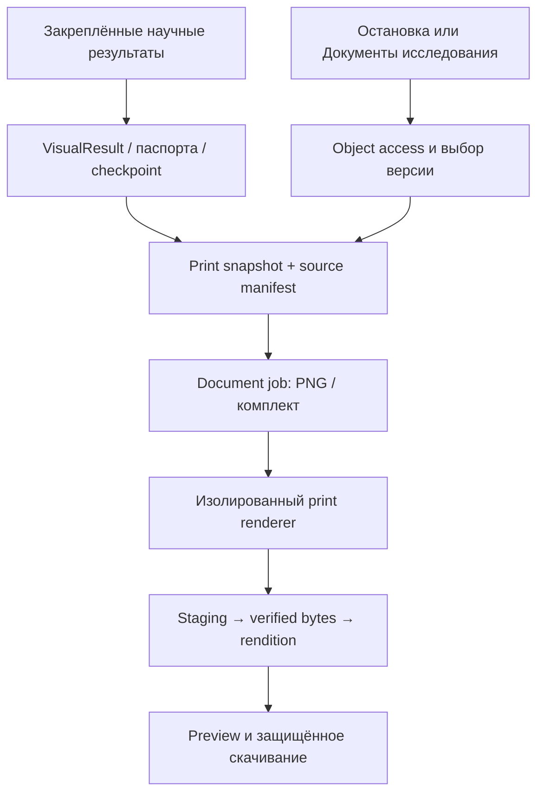

# Научные визуализации и паспорта: архитектура PNG-экспорта

**Редакция 1.0. Дата проектирования: 27 октября 2026 года, Москва.** Проверенная при проектировании база: `2f16f71558e1197da8b2253cd04e34830f2066e0`. **Статус: проект; runtime не реализован этой поставкой.** Родительский контракт — `spec_documentation_logging.md`, особенно §7, §9–12, §15–20.

**Примечание повторной выдачи:** файл восстановлен по содержанию этого диалога после утраты прежнего временного файла. Это повторная документная поставка, не новая синхронизация или сертификация кода. Ниже сохранены архитектурные решения, 18 задач и 24 приёмочных сценария. Исходный ZIP с историческими worklog/протоколами не восстановлен побайтно; новый архив содержит спецификацию и пояснение состава.

## 1. Требования и граница

**Путь A:** аналитик на любой остановке с реальной научной визуализацией выбирает «Скачать PNG», получает светлое печатное представление с заголовком, датами, осями и единицами, легендой, пояснениями и идентификаторами источника. Включаются графики, тепловые карты, научные матрицы и диаграммы, уже отображаемые таблицами HTML. Предварительное создание итогового отчёта не требуется.

**Путь B:** в «Документах исследования» аналитик восстанавливает сохранённые паспорта свойств ряда и их сравнение, выбирает исторические версии, просматривает печатный макет и скачивает PNG либо комплект PNG в ZIP. Путь работает без активного DataFrame и без живой исследовательской cookie-сессии, если сохранены durable-источники и действует объектный доступ.

**PNG-only:** новые пользовательские экспорты изображений — PNG. SVG как скачиваемый формат не проектируется; внутренний SVG Recharts допустим. PDF/CSV/JSON/MD действующих документов не удаляются. Старые SVG rendition/ссылки сохраняют прежнюю политику чтения, но не предлагаются как новый scientific export. ZIP — контейнер PNG и метаданных.

Декоративные волны, иконки, иллюстрации навигации, placeholder/soon и интерфейсы без научных данных исключаются. Реальные научные preview Навигатора входят в охват; статическое демо маркируется и не становится результатом исследования. Новые научные алгоритмы, полноценное совместное редактирование и новый сервис идентификации не входят в задачу.

## 2. Состояние исходников при проектировании

Fetch, HEAD и AGENTS.md проверены в первоначальном исследовании, включая GitHub-read точного ref. Разница с fe790c5 касалась document_renditions, Dockerfile/requirements, startup/health и тестов PDF dependency/environment; новых научных PNG-путей она не добавляла. Production deployment и browser-E2E этой спецификацией не сертифицированы.

| Исходник | Установленный факт и точка расширения |
|---|---|
| packages/ui/components/ForecastExportMenu.tsx | PNG из первого SVG контейнера; отдельный forecast path, не универсальный export |
| packages/ui/components/DistributionCharts.tsx | Scatter/histogram/KDE — три самостоятельных изображения и опциональный лист распределения |
| packages/ui/components/EdaIhOverview.tsx | IH «Условная карта» — HTML table; SVG-only сериализация не подходит |
| packages/ui/components/ExpandableChartPanel.tsx | Раскрытие панели, не print renderer; визуализации существуют и вне этой обёртки |
| packages/ui/components/DatasetPassportPanel.tsx | Четыре точки; при открытии загружается status, а не полное историческое содержимое; сравнение HTML |
| packages/ui/components/DocumentationWorkspace.tsx | Каталог D01–D12, общий селектор без PNG/SVG; необходимы новые типы представлений и picker источников |
| packages/ui/components/TasksCauses.tsx | Реально вычисленная XAI-визуализация входит в покрытие |
| packages/ui/components/BacktestOofChart.tsx | Modeling OOF требует явных result refs/folds и сопоставимости |
| packages/ui/components/ForecastChart.tsx | Origin/horizon/intervals и историческое окно должны попасть в подпись |
| packages/ui/lib/chartVars.ts | Уже есть светлая палитра; расширить общим print contract |
| apps/api/routers/session.py | Capture/compare паспортов зависят от текущей session; новый reader не вызывает capture |
| apps/api/session_store.py | Snapshot history и modeling_entry checkpoint; TTL не архив |
| app/core/passport.py | _compare_ts_props — общая семантика сравнения без пересчёта паспорта из ряда |
| apps/api/artifact_promotion.py | Паспорт переносится в durable payload; modeling_entry может ссылаться на предыдущий stage snapshot |
| apps/api/promotion_integration.py | Единая producer→artifact интеграция; расширять её |
| apps/api/artifact_store.py | Нужны versioned kinds/schema научных render inputs и checkpoint |
| apps/api/report_snapshot.py | Frozen document basis; D01–D12 не переименовывать |
| apps/api/snapshot_builder.py | D02 не полный паспортный комплект; D05 не полный каталог EDA chart bytes |
| apps/api/document_renditions.py | build_chart_spec рисует «Утверждения по секциям документа», а не научный график |
| apps/api/document_jobs.py | Jobs, cancel/CAS, staged bytes→ready; переиспользовать |
| apps/api/document_render_worker.py | Python worker документов; нового browser renderer ещё нет |
| apps/api/identity.py | SubjectRef, authorize_run_access, uniform 404 и legacy policy сохраняются |
| apps/api/Dockerfile | Python runtime и PDF/PNG fonts не обеспечивают Chromium/Node renderer |

Одного passport payload недостаточно для восстановления точного EDA handoff. Нужен durable **passport_checkpoint**: факт подтверждения, snapshot_id, previous_snapshot_id, source_stage, created_snapshot, confirmed_at и точный набор версий траектории. Время промоушена нельзя подставлять вместо времени подтверждения; повторное подтверждение не является новым физическим паспортом.

## 3. Инварианты

1. Export/render/read не запускают научный расчёт, capture или preprocessing и не меняют scientific ledger. Document/render jobs, pins и delivery audit — отдельные допустимые записи документного слоя.
2. Renderer получает frozen typed payload и закреплённые result refs. Источником не служат текущий DOM аналитика, cookie-relative GET с расчётами или произвольный HTML клиента.
3. На страницах видимы тип представления, target/entity, контекст и версия данных, время результата/фиксации, версия документа. Stale относительно текущих данных не уничтожает историческую действительность.
4. Всегда light-print: непрозрачный белый фон, читаемые текст/цвета/научные признаки независимо от экранной темы.
5. Metadata/preview/job/content/ZIP проходят одну object authorization. ID/hash/подписанная ссылка не заменяют право доступа. Raw данные не вкладываются автоматически.
6. Отсутствие, усечение, агрегация, panel и reused checkpoint маркируются; неполнота не подменяется нулями.
7. «Все визуализации» подтверждается полным инвентарём render sites, а не числом файлов Recharts/ExpandableChartPanel.

## 4. Общая архитектура

Логический микросервис «Документы» остаётся внутри текущего API. Добавляются registry научных представлений, durable print inputs и изолированный PNG renderer worker. Lifecycle/jobs/download/audit не дублируются.

Проектируемые модули:

- `apps/api/visual_exports.py` — orchestration/registry adapter;
- `apps/api/passport_documents.py` — durable reader/trajectory resolver;
- `packages/ui/print/` — общие pure renderers/print layout;
- `apps/print-renderer/` — Node/Playwright worker adapter;
- adapters результатов — рядом с действующими producer modules.

Эти пути — проектные, не заявление об их реализации. Python jobs остаются authority. Новый worker получает разрешённую PNG job через service interface/lease; только backend завершает staged object/CAS→ready. Для v1 рекомендуется отдельный print-renderer container с фиксированным build/readiness и ресурсными ограничениями, а не установка Chromium в scientific API image. Альтернативный локальный subprocess допустим лишь при сохранении тех же isolation/kill/lease гарантий.

### 4.1 Browser renderer

Общий print bundle рендерит Recharts/SVG, HTML IH, матрицы, паспорта и сравнения. Playwright снимает специально построенную print page, а не текущий экран пользователя. Fetch/state/animation отделяются от pure presentation, чтобы screen и print переиспользовали научную геометрию без второй реализации на Python.

Фиксируются Chromium/Playwright, шрифты, locale/timezone, device scale, renderer_version. Ожидание fonts.ready и явного render-ready после layout обязательно. Анимации, hover/tooltips, «сейчас», transitions и случайные IDs выключены. Timeout не является признаком готовности. Публичный Next route с cookie аналитика не используется как источник renderer.

Worker не получает пользовательские credentials, исходящую сеть, произвольный filesystem и user JS. Только локальные bundled templates/assets и typed escaped JSON. Non-root/sandbox, лимиты процессов/памяти, закрытый renderer interface. Первичные источники выбора технологии: https://playwright.dev/docs/screenshots и https://playwright.dev/docs/docker . Новая browser dependency не считается установленной из-за ранее исправленного PDF deployment.

## 5. Инвентарь всех остановок

PGV-00 создаёт machine-readable registry: view_id, module_id, stop_id, render_site, renderer_kind, source_adapter, required refs, view params, applicability, caption schema, export status и tests. Один reusable chart может иметь несколько sites; регистрация файла не означает покрытия всех мест.

| Область | Обязательный охват | Особенности |
|---|---|---|
| Загрузка/реальные preview Навигатора | Ряд, scatter, histogram, KDE, реальные научные схемы/матрицы структуры, distribution sheet | Target, sampling, пропуски/частоты; отдельные графики и лист |
| Валидация | Все реальные charts/heatmaps data types, regularity, uniqueness, range, inclusion, text quality, consistency, referential, sufficiency | Counts/rates/знаменатели, различать проверку и preview коррекции |
| Предобработка | Missing, outliers, regularity, smoothing, scaling, variance, stationarity, spectral, decomposition, feature engineering | Before/after, preview/applied, метод/параметры, входная/выходная версия |
| EDA | Descriptive, distribution, stationarity, seasonality, correlation, structural breaks, IH, feature selection, validation strategy, model matrix | Каждый selectable subview, HTML-карты, лаги/тесты/ограничения |
| Моделирование | Реальные workflow/traceability научные виды, OOF, backtest comparisons, diagnostics, tuning, panel | Model/card/execution/folds/cohort, uncertainty; не controls/spinner |
| Прогнозирование | Все реальные single/panel forecast charts, intervals, comparisons | Frozen origin/as-of, alpha/метод, inverse transform, horizon/entity |
| Задачи | XAI «Причины» и другие обнаруженные реальные sites | not_computed остаётся unavailable; будущие методы не фабрикуются |
| Паспорта | start/validation/exit/modeling_entry, отдельно panel_entry, таблицы/сравнение | Version picker и печатные страницы без обрезки |

JSX render branches, stop/method registry и динамические panel/entity переключения обходятся явно. Поиск recharts/svg/canvas/HTML table/CSS heatmap — вспомогательный oracle. Decoration exclusions имеют причины. Unknown/unmapped scientific site блокирует CERT и остаётся в denominator coverage.

## 6. Данные и метаданные визуализаций

**VisualResult/1** — immutable artifact с нормализованными данными уже вычисленного результата: series/tables/matrix/ordering, units/null reasons, selections, parameters, sampling/aggregation, uncertainty, warnings, execution/result ref и digest. Не только PNG/screen SVG. Новый kind `visual_result` расширяет schema/migrations/pins/tests.

Producer adapter фиксирует print input при фиксации результата либо первом explicit export ещё доступного проверенного результата. Для lazy GET результат переносится из фактического response в durable слой идемпотентно; renderer не вызывает GET для повторной науки. Клиент передаёт ref и allowlisted display selection, а не authoritative series/caption. Response содержит result_ref/context/version token. CAS freeze проверяет соответствие изображённой версии; при изменении данных — 409 context_changed с выбором обновления или сохранённой версии.

**VisualPrintSnapshot/1** содержит:

- run_id, tenant/ownership ref, context_id, data_revision, data artifact id и source_hash; для БД hash извлечённого результата вместо выдуманного source-file hash;
- view_id, result/artifact ref/version/hash, stop/module, target/date/entity, before/after input/output revisions;
- computed_at/captured_at/checkpoint confirmed_at при наличии; render_requested_at отдельно; timezone/locale;
- title/subtitle, axes names/units/scales/limits, legend/category ordering/series styles, heatmap scale/domain;
- method/parameters, time window/scope, counts/denominators, sampling/point cap/truncation, interval/test semantics, annotation revision;
- print profile, renderer/font/theme/schema versions, pinned dependencies и policy чувствительных полей.

У таблицы/схемы axes_applicability=not_applicable: нужны row/column headings, единицы и легенда обозначений/цвета. Не выдумывать единицы и timestamps. Analyst annotation — отдельный versioned текст, не silent edit canonical result.

## 7. PNG и печатная композиция

Профили: figure-landscape и A4 portrait/landscape. A4 при 300 ppi — 2480×3508 либо 3508×2480 px. Это физический профиль, не увеличение информативности выборки. Manifest хранит intended size и pixels; PNG содержит pHYs density. UI предлагает «Рисунок»/«Лист A4», не произвольный HTML viewport.

Верх — заголовок/номер, источник/target/entity, даты. Центр — рисунок/таблица, читаемые axes/ticks и полная legend. Низ — методы/параметры/пояснения/ограничения, версия данных, короткие IDs, page number; полные refs в metadata. SamplingBadge/легенда не теряются при раскрытии. Цвета/штриховки/линии устойчивы, красный/зелёный не единственный носитель смысла.

Длинные таблицы/подписи пагинируются до rasterization: повторять headers/footers, не разрезать строки/оси/legend. Широкие матрицы — labelled column bands с row headers и одной color scale. Нельзя уменьшать до нечитаемого шрифта. Неделимый график требует другого профиля/размера либо явного отказа. Безразмерный fullPage PNG не используется.

Начальные потолки: 12 MP/page, 20 страниц, 50 MiB output/job, timeout 60 s, concurrency tenant=1/global=2 для отдельного worker. Нужен benchmark целевого deployment до заявления SLA. Превышение — 413 export_too_large, без скрытого усечения. Полный паспортный комплект полностью проходит preflight либо завершается явным отказом. Partial доступен только явно с gaps.

Одна страница → PNG и отдельно metadata JSON. Несколько/«Все паспорта» → ZIP PNG+manifest.json+metadata.json, без DataFrame по умолчанию. Manifest: порядок, filenames, page roles, dependencies, pixel/physical profile, render_version и PNG hashes. Hash PNG нельзя помещать внутрь тех же bytes; хранить отдельно, исключить циклическую зависимость. Изображение не числовой первоисточник.

## 8. Durable паспорта и точная история

`PassportHistoryReader` читает registry/ObjectStore, а не SessionStore. Snapshot включает полные groups/metrics/categories/lists/reasons/warnings, schema/calculation version, target/date/entity, snapshot_id, fingerprint/context/data_revision, captured/created time и data_ref. source_hash и fingerprint — разные поля с определением алгоритмов.

Новый artifact kind **passport_checkpoint** фиксирует каждый EDA handoff, включая reused snapshot: checkpoint_id, stage=modeling_entry, confirmed_at, snapshot/previous refs, created/reused/unchanged flags, точные start/validation/exit refs на момент подтверждения и context. Идемпотентность по checkpoint_id; passport producer_key остаётся по snapshot_id. Unchanged EDA не создаёт четвёртый физический паспорт: печатаются подтверждение и ссылка на исходный снимок.

Capture фиксирует scientific результат, promotion_integration переносит его с receipt/retry без повторной науки. Promotion failure виден UI; durable документ не обещается до commit. Старые snapshots не переписываются. Backfill получает недостающую metadata только из доказуемых session/ledger/artifact records, сохраняет provenance. Утраченные refs/date → legacy_unknown, не догадка.

Version picker: run/context/target/entity/time, IDs, stage, fingerprint/data version и актуальность. Default — «Траектория на выбранное подтверждение EDA», не latest каждой стадии. Иная цель/ветка/context — отдельная trajectory. panel_entry отдельно от single-series.

Печатный паспорт выводит все группы существующей схемы, units, unavailable reasons/warnings/schema/calculation version и provenance. Не сокращается до rows/columns/claim counts. Неизвестная schema — unsupported_schema/missing fields, не пустая «готовая» картинка.

## 9. Сравнение паспортов

Общий pure comparison engine выделяется из session orchestration: существующая `_compare_ts_props` через versioned adapter, без дублирования формул в TypeScript. Вход — immutable refs. Frozen **PassportComparisonSnapshot/1**: ordered refs/path, checkpoint metadata, numeric deltas/category/list/qualitative changes, method/schema versions, gaps/context.

Default resolver использует trajectory checkpoint. При произвольном выборе UI показывает IDs. Несовместимые target/entity/units/schema → 409 comparison_incompatible. Cross-context historical comparison — только явный режим с проверкой сопоставимости и маркировкой. Panel entities не смешиваются.

Unchanged modeling_entry не добавляет нулевую дублирующую колонку; отдельная строка подтверждения содержит confirmed_at и reused ref. Missing validation — gap, не ноль. Complete требует всех применимых сохранённых точек; partial явно перечисляет пропуски.

Печатаются значения по этапам, absolute/relative changes с определением и zero-denominator reason, categories/lists/qualitative explanations. Цвет delta не означает статистическую значимость. Пагинация повторяет этапы/колонки, source refs и номера страниц.

## 10. Пользовательские пути

### 10.1 PNG на каждой научной остановке

В action bar — «Скачать PNG» с accessible названием вида. У трёх distribution charts — кнопки отдельно и опциональный общий лист. Не смешивать с «Развернуть». Current view фиксирует filters/entity/series/window/zoom; «Полный диапазон» только при сохранённых полных данных. detail_level=expanded/sampling не заменяются новым расчётом молча.

Нажатие → print preview/profile/metadata → подтверждение → async job → attachment download. Переход между модулями не теряет job: V01 доступен в «Документах исследования → Визуализации». Unavailable/loading имеет причину; meaningful empty result может экспортироваться с подписью, отсутствующий расчёт — нет. Stale/invalid warnings сохраняются.

ForecastExportMenu PNG переводится на общий pipeline с сохранением CSV/JSON и audit. До переключения browser PNG остаётся legacy download, не архивным воспроизводимым export.

### 10.2 Паспорта в «Документах исследования»

Фильтры «Визуализации»/«Паспорта свойств». Аддитивные типы: **V01** scientific visual, **P01** saved passport/комплект, **P02** comparison. D01–D12 и D02 source passport сохраняют смысл. Требуются versioned catalog/validators/API/UI/SQL changes, не переименование D02.

«Восстановить паспорта» → context/trajectory/checkpoint → сохранённые точки/gaps → один/все → «Создать печатное представление». Создаётся revision с frozen refs/pins без capture и перерасчёта. «Сравнить паспорта» создаёт P02 тем же lifecycle. Producer автоматически сохраняет basis artifacts, но не плодит документы на каждый capture.

Preview соответствует скачиваемой версии/профилю. Одна страница — «Скачать PNG», несколько — «Скачать все страницы PNG (ZIP)». Общий PNG для D01–D12 допустим лишь при реальном page renderer, не claims chart. Старый claims chart явно подписывается «Структура документа: число утверждений».

## 11. API, lifecycle и безопасность

Предлагаемые, ещё не реализованные контракты:

| Операция | Назначение |
|---|---|
| GET /v1/documentation/runs/{run_id}/visual-sources | Доступные frozen inputs/views/applicability/metadata, без запуска науки |
| POST /v1/documentation/runs/{run_id}/visuals | view_id/result_ref/selection/expected context/profile → V01 revision/job |
| GET /v1/documentation/runs/{run_id}/passport-sources | Durable versions/checkpoints/trajectories/gaps без session DataFrame |
| POST /v1/documentation/runs/{run_id}/passport-documents | refs/checkpoint, single/set/compare, complete/partial → P01/P02 |
| Existing revision/rendition/jobs/content | PNG/page-set options, текущие polling/cancel/retry/delivery; один job store |

POST создаёт freeze/document/render, GET не меняет scientific state. Idempotency scoped по subject/tenant/run/action+payload digest; иной payload с прежним key → 409. Cache key: snapshot hash+view/selection+profile+theme/font/renderer versions+page index. Retry возвращает existing ready bytes/job, не science.

Порядок: AuthN → tenant/run/object access → documentation.write/export и artifact.data.read для чувствительного содержимого → version policy → refs. Read не даёт data export автоматически. Uniform 404 для чужих объектов. Captions не содержат credentials/SQL/DSN/локальные пути; плановые watermark/retention сохраняются. Worker использует service capability, не admin cookie. Revoke после queue закрывает delivery; доступ проверяется заново.

Ошибки: 409 context_changed/source_unavailable/comparison_incompatible; 413 export_too_large; 422 invalid_selection/profile; 429 quota/concurrency; 503 renderer/store unavailable. Hash mismatch — failed integrity_error, не новый расчёт. render_dependency_unavailable — deterministic terminal failure, без бесполезного retry.

Reuse queued/rendering/ready/failed/cancel, staging/ObjectStore/pins. CAS перед ready предотвращает late publication после cancel. Timeout убивает browser process/context, не оставляет неограниченный thread; temp cleanup обязателен. Mandatory audit до защищённой выдачи. Stream start не равен факту полной загрузки; audit без сырого series payload.

## 12. Эксплуатация и совместимость

Readiness отдельно проверяет browser/fonts/print bundle и smoke PNG кириллицы+IH+passport. Safe /health/ops классифицирует PNG отдельно от PDF, без DSN/секретов. Пакет/browser версии совместимы и pinned; Chrome хоста не prerequisite. No-network/non-root sandbox; user HTML/SVG запрещён.

Immutable bytes/hash не рендерятся заново при download. Новый renderer создаёт новую rendition revision, не меняет старую. Byte determinism только в pinned runtime; между builds — semantic/visual tolerance. Font/line clipping/кириллица проверяются в final container. Cleanup не ломает pins/holds/retention; источники и PNG могут иметь разные сроки.

Родительская spec уточняется: §7 PNG-only для новых paths; §9 ChartArtifact→VisualResult+PrintSnapshot вместо claims count; §12 V01/P01/P02/source picker; §19 DOCLOG-5 scientific coverage gate. Обновление родительских контрактов — PGV-00/02. Текущий SubjectRef/object gate используется без ожидания нового AuthN сервиса.

## 13. Пошаговые задачи

Каждая будущая итерация: дизайн/риски → RED → код → GREEN → затронутый регресс/build → worklog/ZIP. Таблица — план, не выполненные работы.

| ID | Зависимости | Результат | Точки изменения | Критерий готовности |
|---|---|---|---|---|
| PGV-00 | — | Полный render-site inventory/parent spec | UI stops/methods/branches, spec_documentation_logging | HTML/panel/real navigator включены, exclusions явны, unknown site блокирует CERT |
| PGV-01 | PGV-00 | Print schema/metadata/profile | shared schemas, registry | Result/version/date/units/sampling обязательны по applicability, параметры trusted |
| PGV-02 | PGV-01 | Durable inputs/V01/P01/P02 | artifact_store/report_snapshot/SQL/validators | Versioned migrations и legacy D01–12/readers работают |
| PGV-03 | PGV-02 | Producer adapters | upload/validation/preprocessing/EDA/modeling/forecast/tasks | Freeze сохранённого реального response, CAS версии, export не пересчитывает science |
| PGV-04 | PGV-02 | Durable checkpoint/backfill | promotion_integration/artifact_promotion/capture | Reused handoff хранит confirmed_at/trajectory отдельно, retry без capture |
| PGV-05 | PGV-04 | PassportHistoryReader | passport_documents/ObjectStore/refs | Чтение без Redis/DataFrame, schema gaps/legacy_unknown честны |
| PGV-06 | PGV-05 | Pure comparison resolver | app/core/passport/session adapter | Прежняя семантика refs, cutoff/reuse/incompatible contexts проверены |
| PGV-07 | PGV-01 | Shared pure print layout | packages/ui/print/chartVars/screen charts | Light фон, labels/legend/HTML IH/полные паспорта, без fetch/animation |
| PGV-08 | PGV-07 | Sandboxed renderer container | apps/print-renderer/build/deployment | Final image smoke кириллица/IH/A4, no-network/non-root/hard timeout |
| PGV-09 | PGV-02, PGV-08 | Jobs/PNG renderer integration | document_jobs/render_worker/renditions | Lease/staging/CAS/cancel/missing dependency не дают broken ready |
| PGV-10 | PGV-03, PGV-09 | Export upload/validation/preprocessing | Все render sites этих stops | Верный PNG каждого view, before/after/sampling, не первый SVG |
| PGV-11 | PGV-03, PGV-09 | Export EDA/IH/tasks | Eda*/TasksCauses/chart groups | Полные читаемые карты/матрицы, стабильная scale, unavailable не фабрикуется |
| PGV-12 | PGV-03, PGV-09 | Export modeling/forecast/panel | Backtest/Diagnostics/ForecastExportMenu/panel | Entity/folds/origin/interval metadata верны, CSV/JSON/audit сохранены |
| PGV-13 | PGV-05, PGV-06, PGV-09 | P01/P02 builders | passport_documents/snapshot_builder/lifecycle | Полные паспорта/сравнение из refs, без DataFrame, reused checkpoint работает |
| PGV-14 | PGV-09, PGV-13 | Pagination/page-set/ZIP | Print layout/manifests/download | Нет crop, порядок/hash страниц верны, лимиты не скрыты |
| PGV-15 | PGV-13, PGV-14 | Documents picker/preview/PNG UI | DocumentationWorkspace/lib/documentation/обе apps | Один/все/сравнение по версии, D02 не P01, ZIP страниц доступен |
| PGV-16 | PGV-10, PGV-11, PGV-12, PGV-15 | Security/retention/ops/coverage | identity/audit/pins/health/registry | Foreign refs/SSRF denied, permission/holds/TTL/dependency failure честны |
| PGV-CERT | PGV-16 | Сквозная независимая приёмка | API/browser/container/visual/concurrency suites | Все применимые sites и AC01…24, обе оболочки/final image проверены |

Релиз A — основа 00…09 + 10/11/12 для всех изображений. Релиз B — паспорта 13…15. Общий production release — только 16/CERT. Pilot явно ограничен; «все визуализации» требует полной coverage. Новые scientific sites будущих soon-модулей регистрируют export при добавлении.

## 14. Приёмочные сценарии

| ID | Ожидание |
|---|---|
| PGV-AC01 | Scatter/histogram/KDE отдельно и sheet содержат верный target/units/sampling, не другой subplot |
| PGV-AC02 | IH HTML matrix полностью печатается с bins/процентами/знаменателем/color legend |
| PGV-AC03 | Каждый применимый site каждой остановки имеет PNG action и frozen-data oracle |
| PGV-AC04 | Dark/light экран дают одинаковый light-print в pinned runtime |
| PGV-AC05 | Labels/units/legend/method/date/context/data_revision не теряются compact/expanded |
| PGV-AC06 | Export не вызывает scientific endpoint/capture/apply, не меняет scientific DataFrame/history |
| PGV-AC07 | Смена target/data/entity при freeze → 409 или явный historical ref, не смешанный PNG |
| PGV-AC08 | Sampling/aggregation/zoom/full-range различаются, без скрытого detail upgrade/recompute |
| PGV-AC09 | P01 читает все группы после утраты session/Redis из durable refs |
| PGV-AC10 | Комплект использует выбранную trajectory/исторические версии, не latest каждого stage |
| PGV-AC11 | Reused modeling_entry показывает подтверждение/source snapshot без ложной четвёртой копии |
| PGV-AC12 | Missing/corrupt legacy checkpoint даёт gaps/integrity failure без выдуманной даты |
| PGV-AC13 | P02 numeric/category/list/qualitative, zero denominator reason, несовместимость закрыта |
| PGV-AC14 | Panel_entry/entities не смешиваются с single-series стадиями/другими entities |
| PGV-AC15 | Long table/heatmap paginate без crop/пропавших строк, с повтором labels |
| PGV-AC16 | A4 pixel/300 ppi metadata согласованы, intended proportions сохранены |
| PGV-AC17 | Missing browser/font/bundle → render_dependency_unavailable, не ложный ready |
| PGV-AC18 | Foreign refs/jobs/content/ZIP закрыты uniform 404, изображение не обходит data permissions |
| PGV-AC19 | Script/remote image/SSRF/file URL не исполняются, worker без browser secrets |
| PGV-AC20 | Cancel/timeout/crash/late completion/retry не публикуют canceled output и не повторяют science |
| PGV-AC21 | ZIP содержит согласованные страницы/manifest/hash/metadata без raw DataFrame/чужих artifacts |
| PGV-AC22 | D01–D12/PDF/legacy reads и forecast CSV/JSON сохранены, claims chart не scientific export |
| PGV-AC23 | Final container visual/OCR/semantic checks ловят кириллицу/clipping/transparent фон/нечитаемость |
| PGV-AC24 | PNG/полный комплект работают в обеих оболочках после navigation/worker restart/revoke |

Oracle data: собственный небольшой ряд с пропусками/выбросами и известными counts/rates/bins, IH matrix с известными суммами, checkpoint new/reused/changed/missing, длинные русские подписи/широкая таблица. PNG/screen сверяются с данными, не только snapshot реализации. Мутанты wrong ref, removed legend, forced dark, crop-last-row, drop checkpoint, duplicate unchanged column, ignore permission/cancel, missing font должны убиваться oracle. Mock browser не заменяет image/container E2E.

## 15. Риски и проверка

Риски: неполный registry, скрытый научный перерасчёт, неверная версия данных, потеря checkpoint, crop видимой области, data leak, тяжёлый browser runtime, fonts mismatch, claims chart вместо scientific figure. Меры/критерии заданы выше. До launch измеряются memory/throughput, historical backfill completeness и retention. Отсутствующий historical source не заменяется текущим.

При первоначальной выдаче doc-contract RED→GREEN проверял base/status, 23 source paths, инварианты/DAG/24 AC и Markdown; сообщённый результат 6/6 относится к той проверке, не к runtime. В повторном архиве исходные протоколы и worklog отсутствуют: они не воссоздаются как будто выполнены заново. Для восстановленного файла отдельно проверяются структура 18 задач/24 AC, Markdown и целостность ZIP. Runtime код/build/научные вычисления повторной выдачей не затрагиваются.
